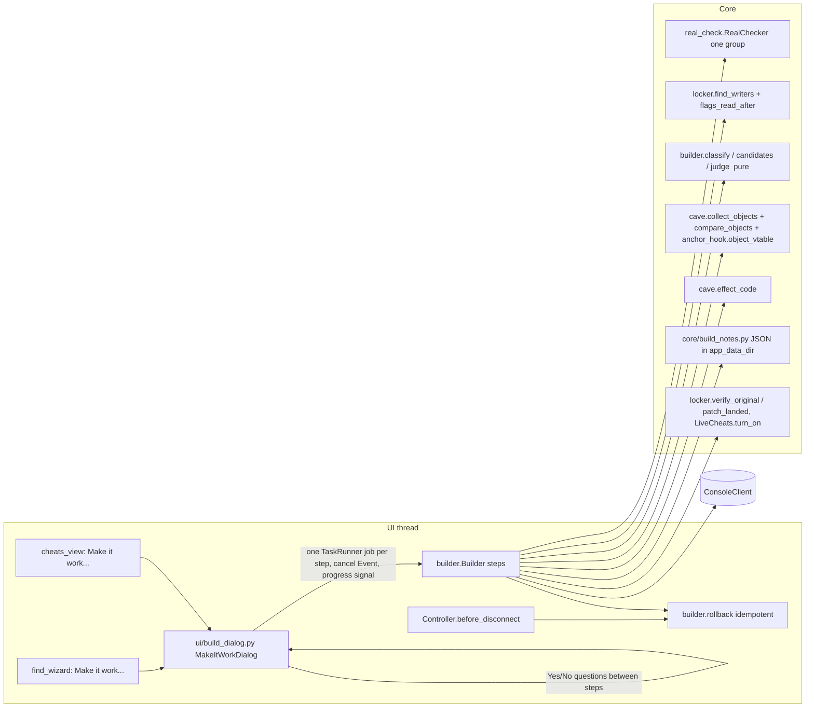

# Smart cheat builder ("Make it work"): design

Date: 2026-11-11. Spec: docs/spec-cheat-builder.md (OPEN items use their defaults).
No new runtime dependency: iced-x86 does all encoding/decoding, JSON notes use the stdlib.
unicorn stays an optional, test-only `importorskip` (GPLv2 engine, never shipped).

Narrowed rule S3: it only matters for writers that **change flags** (`sub`/`add`/`dec`
into memory). A `mov`/`vmovss` writer leaves flags untouched, so NOPing or hooking it with
pushfq/popfq leaves later flag readers seeing what they always saw.

## Overview



States: [RealCheck] -> Watching -> Classified -> [Collecting] -> Installing -> Testing ->
(Asking) -> Passed | RolledBack -> next candidate (max 6) | NothingWorked; Testing -> Lost
on Alive failure or link loss (put back at once, crash mark); Passed -> [B7 neighbour] ->
Done (swap to counter-less routine, replace source row).

The dialog drives a `Builder` step by step. Each step (real check, watch, collect, one
candidate's install+test, finalize) is one `ctl.tasks.run` job with a `threading.Event`
for cancel and `(fraction, hint)` progress via the `_Signals` pattern. Questions are asked
on the UI thread between steps: a test step returns `NEEDS_ANSWER` and the dialog feeds the
answer to pure `judge()`. No worker blocks on the UI.

Every console change goes through one `Builder._installed` record under a lock, so rollback
is idempotent (worker `finally`, Cancel, or `Controller.before_disconnect`). A crash note
in `app_data_dir()/build_notes.json` is open while any candidate's bytes are in the game.

## (1) Routine generation: `cave.effect_code`

```python
def effect_code(span, target: Target, vtype: ValueType, effect: Effect, cave: int,
                *, full: bytes | None = None, counter: int | None = None,
                only_me: Filter | None = None, flags_fix: bool = False) -> bytes
```

`Effect` = NEVER_DOWN | ALWAYS_FULL | HALF. `Filter` reuses capture_code's
`(kind, vtable | field, field_value)`.

```
lea rsp,[rsp-128] ; pushfq                    ; red zone + flags, as capture_code
[only me: cmp qword [obj],vt | cmp dword [obj+f],v ; jne other]
popfq
push qword [obj+disp]                         ; OLD on the stack (no flag/reg change)
<game's writer copy>                          ; S5: game's store runs first, sets flags
pushfq ; push rax  (FLOAT: also lea rsp,-32 ; movups [rsp],xmm0 ; movups [rsp+16],xmm1)
  load NEW from [obj+disp]; compare with OLD at [rsp+k]:
   NEVER_DOWN  int: cmp new,old ; jge game_ok (signed)  float: ucomiss ; jae/jp game_ok
               -> mov [obj+disp], OLD
   ALWAYS_FULL -> _stores(target, full)   (immediate: value_positions keeps Full editable)
   HALF        int: d=old-new (jo -> game_ok) ; new' = old-((d+1)>>1)   (7->4, 1->1)
               float: new' = (old+new)*0.5 ; NaN -> game_ok
  [counter: inc qword [rip+slot] ; mov [rip+slot+8], game's NEW]   <- test build only
  restore xmm/rax ; popfq
  ours: [flags_fix: cmp dword|qword [obj+disp],0]  -> ZF/SF from stored value, OF=0
  tail: lea rsp,[rsp+136] ; <rest of span> ; jmp back
game_ok: [counter lines] restore ; popfq ; jmp tail        (game flags untouched)
other:   popfq ; lea rsp,[rsp+128] ; <original span> ; jmp back
```

- Legacy SSE only (`movss`, `movups`, `ucomiss`, `addss`, `mulss`), not VEX (VEX zeroes
  upper YMM; the save area holds 128 bits).
- Only GPR scratch is `rax` (use `rcx` via `_scratch` if the object register is `rax`).
- Flags: game path `popfq` restores what the writer left. Replaced path: `flags_fix` only
  when the writer modifies flags and a following instruction reads ZF/SF/OF. CF/PF/AF
  readers -> writer skipped by `classify`.
- Counter: `cave.find_slot`, 16 bytes `[count u64][last game NEW]`. The saved cheat is
  `effect_code(..., counter=None)`; a test asserts the decoded instruction lists differ
  only by the counter lines.
- Swap at pass: counter-less routine into the second reserved room, jump re-aimed with one
  5-byte write (routine line first, then jump); after 2 s the test room and slot are zeroed.
- Placement: `BUILD_CAVE_SKIP = 5 * CAVE_ROOM`, `find_cave(session, 2*CAVE_ROOM,
  skip=BUILD_CAVE_SKIP, extra_reserved=...)` so rooms used by CODE_PATCH lines of open
  cheats are never reused. Assert `len(code) <= CAVE_ROOM`.
- Saved lines: routine line on == off (as `anchor_hook.hook_cheat`); jump line on = jmp,
  off = original. Plain NOP reuses `locker.make_lock_cheat`.

## (2) Flags reader and two existing bugs

```python
@dataclass(frozen=True)
class FlagsUse: read: frozenset[str]; unknown: bool    # CF PF AF ZF SF OF
def flags_read_after(read: Read, writer: Writer, budget: int = 32) -> FlagsUse
```

Decode forward from the writer's end. Pending = flags the writer modifies
(`rflags_modified`); empty -> `read=∅`. Each instruction: add `rflags_read & pending` to
read, remove `rflags_modified` from pending. `jcc`: count the read, follow both ways within
budget. `jmp rel`: follow. `ret`/`call`: stop (flags dead under SysV). Indirect jmp,
invalid code, or budget out with flags pending: `unknown=True`.

- Bug 1 (Lock it NOP ignores flags read after the writer): in `locker.find_writers`, read
  64 bytes after the writer, compute `FlagsUse`; if read non-empty or unknown, set
  `unsafe = "the game checks the result right after it"`. New `Writer.flags` field
  (default None). Lock it's existing `unsafe` handling then covers it.
- Bug 2 (Player only's `cmp` clobbers flags): wrap `cave.player_only_code`'s cmp/jne in
  `lea rsp,[rsp-128] ; pushfq ... popfq ; lea rsp,[rsp+128]` on both paths; on the player
  path run the game's writer copy first and store the kept value over it (capture_code
  pattern). Update the Returnal byte test; old saved Player-only cheats keep old bytes.

## (3) Builder: `core/builder.py`

Pure: `classify(writers, vtype, effect, only_me, crashed) -> (eligible, skipped)` (S1
shared, S2 unsafe, S3 flags, S4 store size != vtype.size or >1 memory write, S7 crashed);
`candidates(eligible, effect, only_me)` (most hits first, table order, then "1st method on
all" when >=2 eligible, cap 6); `judge(...)` with the B5 tolerances (half damage: each drop
between polls with exactly one counter tick matches `(prev+game_new)/2` or
`prev-ceil(d/2)`, within 2%; at least one).

Console steps on `Builder` (sleep/clock injected): `real_check(group)`, `watch()` (release
freeze, read Full, `find_writers(..., until=...)`), `collect()`, `try_candidate(c) ->
TestOutcome` (S6 checks, open note, write routine then jump, `patch_landed`, 20 s loop;
rollback in `finally` unless PASS or NEEDS_ANSWER), `finalize() -> Cheat`.

`rollback(reason)`: pop `_installed` under the lock (second call no-op), write original at
the site, wait 2 s, zero room + slot, clear note. On `ConnectionLost`/`WriteFailed` return
`NOT_RESTORED` ("Restart the game: fixes only live in memory until then.").

Crash note `core/build_notes.py`, atomic tmp+replace:
`{"open": {title_id, version, pid, site_off, orig_hex, jmp_hex, method, n, rooms, time} |
null, "crashed": [{title_id, version, writer_off, method, time}]}`. API: `open_note`,
`clear_note`, `is_crashed`, `mark_crashed`, `check_on_connect(session) -> str | None`
(jump still there in the same pid -> roll back, not a crash; else mark crashed and say so).

## (4) Alive check

Every 250 ms (`POLL_S`): read target(s) + 16-byte slot (+ up to 4 other objects' fields
with Only me). Every 1 s: `read(pid, site, 5)` must answer within 2 s and hold our jump;
`foreground_app()` pid/title match (fallback `processes()` every 3 s when unsupported).
`ConnectionLost`/`ReadFailed` -> not Alive -> Lost. Access-watchpoint heartbeat (A1) is
deferred behind a constant. Console test C18a confirms read-failure timing, foreground_app
support, and whether 100 ms polling is sustainable.

`until: Callable[[list[WatchHit], float], bool] | None = None` keyword on
`ConsoleClient.watch` / `watch_writes` (NG loop checks after each hit and each idle tick;
fake calls it once), passed through `find_writers`; also stops the watch on Cancel.

## (5) Tests

- `tests/minicpu.py`: tiny interpreter over iced-x86 instructions for the closed set the
  generators emit plus the fake writer forms; unknown mnemonic raises.
- `tests/fakegame.py`: `Game.hit(obj, new, form)` runs the routine via minicpu when the
  site holds a jump; damage script; INT32/INT64 objects and a `sub [rax+2ACh],ecx ; jle`
  site. FakeConsole: `drop_code_writes`, `until` in watch.
- Routine matrix: type x effect x filter x write (lower/raise/equal) x flags; asserts
  stored value, counter, registers/red zone/rsp unchanged, flags rules, enemy path
  identical.
- Pure tests for classify / candidates / judge / flags_read_after; flow tests with a sync
  TaskRunner; rollback invariant: every fail path leaves module bytes as snapshotted.

## (6) UI

`ui/build_dialog.py` `MakeItWorkDialog`: hint, radio Never goes down (default) / Always
full / Half damage, Only me checkbox, Full field (Always full), Start / Cancel, progress,
Advanced list (writers, skipped with reasons, candidates tried). Yes/No via QMessageBox.
One-time "Save your game first" notice with "Don't show again"
(`Settings.build_notice_hidden`). Buttons: Find action row after Make a cheat; My cheats
next to Lock it (one location, not anchored, connected; else disabled "Pick a single
value."). Unsupported types: "This kind of value isn't supported yet. Use Lock it."
Result replaces the source cheat (as LockWizard.do_keep) or appends from Find, turned on.

## Risks

1. Shared writer without Only me makes enemies unkillable too: hint "If enemies stop
   dying, try again with Only me."
2. The 5-byte jump write isn't atomic (same as Lock it / Player only today).
3. A thread inside the routine at rollback: 2 s delay before zeroing.
4. Static flags analysis: unknown -> unsafe (may skip good writers).
5. Half-damage judging races with many writes per poll: those intervals are skipped.
6. minicpu could get flags wrong: optional unicorn mirror in QA.

## Build order (one PR) and cuts

1. Flags fixes. 2. `until=` on watch. 3. minicpu + fakegame. 4. `effect_code` + matrix
tests. 5. build_notes. 6. builder pure. 7. builder console + flow/rollback tests. 8. UI.
9. Docs (user guide, C18a-e).
Cut order if too big: B7 second address; Only me; early watch end; INT64 half damage.
Steps 1 and 4 must not be cut.
