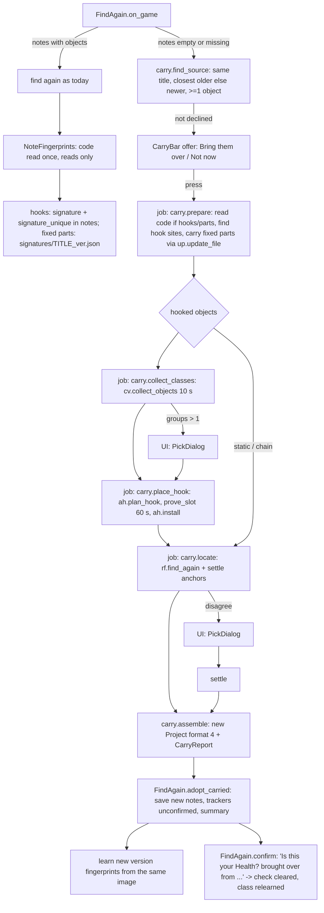

# Architecture: bring your notes to a new game version

Spec: docs/spec-game-update.md (AC-U1..U13). This is the work that architecture v3 D17 left
for v3.1. Internal design only: no new dependency, service or cost. Paid items: none.
Desktop app, single user, existing Python 3.12 + PySide6 + iced-x86 stack.

## Goal & assumptions
After a game update, copy the old version's `.cmproj` notes to a new `{TITLE}_{new}.cmproj`
and find every value's new place: hooks through fingerprints in the new code; statics and
memory paths tried as they are; fixed code parts with the v2 rules. Fingerprints are learned
while the old version still runs. Old notes are never written. Generic for every game.

Scale: one player, one console, usually 1 to 4 objects and up to ~20 cheats per game. The
game's code image is read once per bring-over (C21a measures time and RAM).

Assumptions: iced-x86 `Instruction.code` equality is good enough for "same operation and
operand form"; the NG client copes with a background code read beside find-again reads
(v2 `_maybe_learn` already does this).

## Choice: core "carry" module plus a UI run driver, as phased jobs
- **Core (`core/carry.py`)**: sources, version compare, hook site, field shift, class
  grouping, fixed parts, fingerprint learning, assembling new notes and the report. Each
  live step is one function, run in a worker thread.
- **UI (`ui/carry.py`)**: `CarryOver` (offer bar, run driver, summary), `CarryBar` (widget),
  `NoteFingerprints` (AC-U2 background learner).
- A run is a list of steps; each step is one `ctl.tasks.run` job. A job finishes its part or
  returns a `NeedPick` for the UI thread to answer (`finder.ask_pick`), then the next job is
  queued (as Find again `disagree` and the builder already do). Tests use
  `TaskRunner(sync=True)`.
- Rejected: one worker blocking on a cross-thread dialog (no such mechanism exists); a
  separate dialog window (spec wants a status line).



Hooks installed in a run are recorded with `FindAgain.note_install`, so Cancel, an error or
closing the app takes them out. Only after the last step is the new notes file built and
saved, and trackers created unconfirmed; every first write waits for the "brought over"
question (AC-U8).

## Component choices

| Concern | Choice | Why |
|---|---|---|
| Code reading, fingerprints | `core/updater.py` (`read_code_image`, `make_signature`, `CodeImage`) + small additions | v2 rules already exist |
| Instruction check | iced-x86 (MIT, already used) | - |
| Hook placement, slot proof, install | `ah.plan_hook`, `ah.prove_slot`, `ah.install`, `FindAgain.note_install/take_out` | same rules and rollback as Find it next time |
| Class relearn | `cv.collect_objects` + `ah.object_vtable` + `rf.MapIndex`/`rf.verify` | the Player-only collect |
| Locate after carry | `rf.find_again(..., use_scan=False, learn_chains=False)` | one path for static/chain/slot; gives the disagree case |
| Fixed code parts | `up.update_file` on a temporary `CheatFile` | v2 rules, jump re-aim, cave moves |
| Persistence | `.cmproj` format 4, `signatures/*.json` unchanged, one settings list | readable; older app says "newer Cheat Maker" |
| UI threading | `TaskRunner` phased jobs | existing pattern |

## Data format changes

### `.cmproj` format 4 (`core/project.py`)
- `FORMAT_VERSION = 4`. Formats 1-3 load as today; new keys default off and are written only
  when set.
- `Project.carried_from: str | None = None` -> `"carried_from": "03.000.005"`.
- `ObjectSpec.check: bool = False` -> `"check": true` (brought over, not yet confirmed).
- `ObjectSpec.relearn_class: bool = False` -> `"relearn_class": true` (class cleared at
  carry, learned again at the first Yes).
- `HookAnchor.sig_unique: bool = False` -> `"signature_unique": true` (checked to match once
  in clean code). Older hooks load False and are relearned (AC-U2).
- `ProjectCheat.test: bool = False` -> `"test": true` on a combined cheat whose fixed code
  parts were brought over; cleared at the first successful tick.
- History is never copied; crash marks (build_notes, per version) untouched.

### Other files
- `signatures/{TITLE}_{version}.json`: unchanged format; notes' fixed code parts go in by
  module offset next to v2 lines (`save_signatures` merges).
- `settings.json`: `carry_declined: list[str]`, entries `"PPSA01285 03.000.005>03.001.000"`;
  anything not a list of text resets to `[]`.
- `core/cheats.py`: `Cheat.carried: str = field(default="", compare=False)`, values `""`,
  `"check"`, `"test"`; never saved in cheat files; drives the "Works after restart?" text.

## Per-file changes

### core/updater.py (v2 behaviour unchanged)
- `CodeImage.overlay(originals: Iterable[tuple[int, bytes]]) -> CodeImage`: copy with those
  bytes put back (our jumps/routines/patches replaced by the game's own bytes).
- `CodeImage.zero_run(size, gap=16, *, reserved=(), skip=0)`: reserved module ranges count as
  non-zero; `skip` bytes at the very end are left alone. Defaults keep today's result.
- `update_file(..., *, reserved=(), cave_skip=0)` passes both to `zero_run`.
  `UpdateReport.failed_at: dict[str, int]`: offset of the first bad line per failed cheat.
- `loose(sig) -> Signature | None`: same fingerprint with the first instruction's memory
  displacement also left open (via `Decoder.get_constant_offsets`); None if no displacement.
- `learn_at(image, sites: list[tuple[int, int]]) -> dict[int, Signature]`: for each
  `(offset, min_len)`, `make_signature` with `unique=lambda s: len(image.find(s, 2)) == 1`;
  sites that can't be unique within SIG_MAX are left out.

### core/carry.py (new)
```python
def version_key(v: str) -> tuple            # numeric parts (0, int), text parts (1, text)
def usable_version(v: str) -> bool          # not "", not "unknown"
@dataclass
class Source: project: Project; newer: bool
def find_source(title_id: str, version: str) -> Source | None   # closest older, else closest newer
def list_sources(title_id: str, version: str) -> list[Project]  # Advanced
class CarryFailed(FindFailed): reason: str
@dataclass(frozen=True)
class HookSite: offset: int; code: bytes; text: str; disp: int; how: Literal["exact","loose","original"]
def find_hook_site(hook: HookAnchor, image: CodeImage) -> HookSite   # raises CarryFailed
def carried_object(obj: ObjectSpec) -> ObjectSpec                     # copy; check=True; runs_seen=1 on chains
def shift_fields(obj: ObjectSpec, shift: int) -> None
def reset_class(obj: ObjectSpec) -> None   # vtable None, drop VtableAnchor, default_range around last, relearn_class
@dataclass
class Plan: old: Project; new: Project; image: CodeImage | None; items: list; parts: ...; reserved: list
def prepare(session, old: Project, *, reserved, progress, cancel) -> Plan
@dataclass
class Classes: by_vtable: dict[int | None, list[int]]; plausible: list[int]; objects: list[int]
def collect_classes(session, obj, site: HookSite, *, seconds, cancel, sleep) -> Classes
def choose(classes: Classes, obj, old: ObjectSpec) -> Choice | NeedPick | CarryFailed
def place_hook(session, obj, site, choice, *, prove_seconds, cancel, on_install) -> None
def locate(session, obj, *, cancel) -> rf.Outcome
def settle(session, obj, address: int | None) -> None   # keep only anchors that lead there
def assemble(plan, found: dict[str, int | None], reasons: dict[str, str]) -> tuple[Project, CarryReport]
def learn_note_signatures(project, image, extra=()) -> tuple[int, dict[int, Signature]]
def for_merge(source: Project, into: Project) -> Project   # names not in `into`, ids remapped
def split_hook_cheats(cf: CheatFile, old: Project | None) -> tuple[CheatFile, list[HookLine]]  # AC-U9
def rebuild_hook_cheat(session, line: HookLine, new: Project | None) -> Cheat   # raises CarryFailed
```

Rules:
- **find_hook_site** (AC-U4), in order: (1) `image.find(sig, 2)` exactly 1 hit -> "exact";
  (2) `loose(sig)` exactly 1 hit -> "loose"; (3) only when there is no signature, or it was
  never checked (`sig_unique` False) and 1-2 found nothing: `orig` of 6+ bytes, exactly 1 hit
  -> "original". The instruction at the hit must have the same `ix.Code` as decoded `orig`,
  same base register as `hook.reg`, no index, displacement >= 0, same role
  (`locker.writes_memory`). Otherwise `CarryFailed("the game's code changed where {label}
  was found")`. Text via a new public `locker.insn_text(insn)`.
- **prepare**: read code only if there are hooks or code_patch parts (no read, hook or slot
  check otherwise). Fixed parts: temporary `CheatFile`, one cheat per combined cheat with only
  its `code_patch` parts. A `module_value` part fails the cheat ("it changes a value in the
  game's data, which moves with an update"); a part in another module fails it ("it changes
  another part of the game"). Moved with `up.update_file(tmp, load_signatures(old path),
  image, new_version, reserved=plan.reserved, cave_skip=cv.BUILD_CAVE_SKIP)`; locations map
  back to parts in order; `failed_at` names the part. New cave block added to
  `plan.reserved`. `plan.reserved` = `session.reserved_rooms` + old notes' hook rooms
  (`ah.reserved_rooms(old.objects)`) and fixed caves + CODE_PATCH lines of open cheats in My
  cheats. Items ordered: hooked objects, static, chain, rest.
- **collect_classes**: skipped when the old hook's filter is `none`. Otherwise
  `cv.collect_objects(...)` for `rf.COLLECT_SECONDS`; keep objects that `MapIndex.holds` (in
  writable memory), pass `verify` on a shifted copy with `vtable=None`, and (when the old
  object had a class) whose `ah.object_vtable` points into the module. Group by vtable.
- **choose**: if exactly one group has the old vtable offset, take it. Else one group -> that
  class; several -> `NeedPick` (one `rf.Found(method="hook_slot")` per group, UI opens
  `PickDialog`); none -> `CarryFailed("nothing in the game touched {label} while we
  watched")`. Player-only field guess: find the player by the old guess (as is, then
  shifted); one match -> take it; several plausible -> `NeedPick`; none -> fail. Then
  `cv.compare_objects(player, objects)` gives the new `HookFilter("field")`, or `none`.
- **place_hook**: `ah.plan_hook(..., reserved=plan.reserved + rooms placed so far)` (the
  rooms are passed, never set on the session from a worker; re-checks the 5+ byte
  single-instruction rule, orig bytes from the new code), `ah.prove_slot(..., cancel)`,
  then Cancel and an unchanged game process are checked again, `ah.install`, `on_install`
  (= `finder.note_install`; a run already rolled back takes the hook out at once). Errors
  raise `CarryFailed` with existing plain text. `Item.placed` is set once the hook is in.
- **locate**: `rf.find_again(session, obj, use_scan=False, learn_chains=False,
  cancel=cancel)`; `disagree` goes to the UI (`ask_pick`, then `rf.confirm_pick`).
- **settle**: static kept only if it gives the address; chains that resolve there kept with
  `runs_seen=1`, others dropped; a placed hook kept. No address after a hook was placed
  (slot proven) -> the hook (and its class) is kept and stays in the game, static/chain
  ways are dropped; the object is saved with `check=True` and found by the normal Find
  again path (or the next connect) once the game runs that code; the summary says
  "Health: brought over, not seen yet; take a hit (or change it in the game) and it will
  be found." and its cheats count as brought over. No address and nothing placed -> all
  anchors dropped (saved with no way to be found, AC-U7). Static/chain objects, and hooked
  objects with no class collected, get `reset_class`.
- **assemble**: `Project(title, new_version, process, objects, cheats, history=[],
  carried_from=old.version)`; every object `check=True`; single cheats always copied;
  combined only if every fixed part moved (new offsets/bytes, `test=True` if code parts).
  `CarryReport`: `carried`, `check`, `guessed`, `failed: dict[name, reason]`;
  `summary(version)` gives the v2-style line.
- **learn_note_signatures** (AC-U2, AC-U7): `clean = image.overlay(hooks' (hook, orig) +
  code parts' (offset, off) + extra)`. Hooks with `not sig_unique`, or whose signature
  doesn't match once at their own offset, get `learn_at(clean, [(hook, max(SIG_MIN,
  len(orig)))])`; set `signature`, `sig_unique=True` in place. Code parts missing from the
  signatures file are returned for `save_signatures`.

### ui/find_again.py (FindAgain)
- `keep_rooms` also keeps code_patch caves of the notes' combined cheats (parts whose off
  bytes are all zero).
- `carrying: bool`: while set, Find it next time, Combine and Find it again are off in
  CheatsView; Lock it and Make it work refused in `MainWindow.open_lock/open_build` with
  `CARRY_BUSY`.
- `_track(obj, addr, confirmed)`: tracker creation pulled out of `_done`. `confirmed` is
  always False for `obj.check` objects, even after a pick.
- `adopt_carried(project, found, merge_into=None)`: set or merge `ctl.project`, then
  `ensure_cheats`, trackers, `save()`, `cheats_changed`.
- `ensure_cheats` sets `Cheat.carried` ("test" if `pc.test`, "check" if any of its objects
  has `check`, else "").
- `confirm` / `_confirm_parts`: any object with `check` -> ask `CONFIRM_CARRIED` (single) or
  `CONFIRM_PARTS` with `CARRIED_FROM` in front (combined, one question). Yes ->
  `carried_yes(obj, addr)`: `check=False`; if `relearn_class` and `ah.object_vtable` gives a
  vtable, VtableAnchor back and ranges to `rf.class_range`; save; refresh `carried`. No ->
  `CONFIRM_NO_CARRIED`, nothing written. A Yes in `check_pending` on a check object also
  calls `carried_yes`.
- `tested(cheat)`: after the first successful tick of a "test" cheat: `pc.test=False`,
  update `carried`, save, hint `CARRY_TEST_HINT`.
- `notes_changed` signal, emitted by `save()` and at the end of `_done`.

### ui/carry.py (new)
- `CarryBar(QWidget)`: label, **Bring them over**, **Not now**, QProgressBar, **Cancel**.
  Hidden unless offering or running; above the status row in MainWindow.
- `CarryOver(QObject)(ctl, finder, bar)`:
  - `check_offer(game)` from `FindAgain.on_game` when notes are missing/empty and the
    version is usable: `find_source`, skip declined pairs, show bar, log `action=carry_offer`.
  - Not now adds to `settings.carry_declined` and saves.
  - `start(source, merge=False)`: game connected and in front, else `CARRY_NEEDS_GAME`. Sets
    `finder.carrying`, cancel Event, queues jobs. Progress weights: read 20, collect 10,
    prove 60, locate 10, +1 per static/chain object.
  - Cancel/errors -> `_rollback()`: `finder.take_out` on every object installed in this run,
    `finder.keep_rooms()`; nothing saved; bar shows the offer again. ConnectionLost ->
    `ctl.fail`; offer returns on next connect. Game pid change while running -> cancel.
  - End: `finder.adopt_carried`, summary via `ctl.message` and bar, log `carry_done` and
    `carry_cheat`. Last job: `learn_note_signatures(new, plan.image)` +
    `save_signatures(new path)`, then `finder.save()`.
  - `open_advanced()`: pick a version from `list_sources` (QInputDialog.getItem); if the new
    notes hold objects, run with `for_merge`. Button "Advanced: Bring notes from another
    version..." (it lists newer versions too) next to `skip_hook` in CheatsView, visible with Advanced details.
- `NoteFingerprints(QObject)(ctl, finder)` on `finder.notes_changed`: only when notes are
  for the running version, connected, not `finder.running`/`carrying`, `ctl.code_reading`
  False, and this (title, version) not read yet this run. Reads only if something needs
  learning (decided without reading: any hook `not sig_unique`, or a code part missing from
  the signatures file). Job: `read_code_image(cancel)` + `learn_note_signatures`; applied on
  the UI thread only if `ctl.project` is still the same object, then saved. Cancelled by
  `ctl.before_disconnect` and `on_game`. Logs `action=learn_signature source=notes
  object=.. offset=..` and `action=learn_signatures source=notes saved=N version=..
  seconds=..`.
- `Controller.code_reading: bool` (UI-thread flag), also respected by CheatsView
  `_maybe_learn`: one code read at a time.

### ui/cheats_view.py
- `keeps_text`: "test" -> `Brought over: test it`; "check" (when found again) -> `Found
  again each run (check it)`; then today's rules.
- `_item_changed`: after a successful `turn_on` of a "test" cheat, `finder.tested(c)`.
- `do_update` (AC-U9), worker side: load old notes read-only; `split_hook_cheats` sorts out
  cheats whose two CODE_PATCH lines are the old notes' `hook.hook` jump plus `hook.cave`
  (find it again) or `ah.keep_cave(hook)` (PC off); `update_file` on the rest; each hook
  cheat rebuilt with `rebuild_hook_cheat` (new object matched by label, `ah.hook_cheat`).
  Reasons: "bring your notes over first (My cheats)" (new notes missing/not brought over);
  "the game's code changed where {label} was found" (object has no hook); "make the PC-off
  cheat again (Find it next time)" (PC-off cheat with no editable value). Merge results back
  in the original order and update the report.
- Buttons disabled while `finder.carrying`; Advanced button added.

### Others
- MainWindow creates `CarryOver` and `NoteFingerprints`, adds `CarryBar`, gates
  `open_lock`/`open_build`.
- ui/hints.py (plain words, no "vtable", "cave" or "pointer"): `CARRY_OFFER`,
  `CARRY_OFFER_NEWER`, `CARRY_STEPS`, `CARRY_DONE` pieces, `CARRY_CANCELLED`, `CARRY_BUSY`,
  `CARRY_NEEDS_GAME`, `CONFIRM_CARRIED`, `CARRIED_FROM`, `CONFIRM_NO_CARRIED`,
  `CARRY_TEST_HINT`, `KEEPS_CHECK`, `KEEPS_TEST`, reasons `CARRY_CODE_CHANGED`,
  `CARRY_NOTHING_TOUCHED`, `CARRY_PART_FAILED`, `CARRY_DATA_VALUE`, `HOOK_FILE_FIRST`,
  `ADVANCED_BRING`.
- `Settings.carry_declined`; `Cheat.carried`; `locker.insn_text`.

## Fake PS5: a second game version (tests/fakegame.py)
- `@dataclass(frozen=True) class Layout`: `version`, `code_shift` (where the 4 instructions
  sit), `field_shift` (where HP, HP32, HP64 sit in every object), `vt_shift` (PLAYER_VT,
  ENEMY_VT in RODATA), `static_off` (int32 "Obolites" in module data, default `DATA+0x40`),
  `chain_root` (default `STATIC_PTR`), `changed: bool` (reader uses another base register).
  Properties: `writer`, `reader`, `sub_site`, `mov64_site`, `hp`, `hp32`, `hp64`,
  `player_vt`, `enemy_vt`, `forms`. Instruction bytes made by replacing the trailing disp32.
- `V1 = Layout("03.000.005")` (today's values; module constants stay as V1 aliases, so
  existing tests are unchanged). `V2 = Layout("03.001.000", code_shift=0x80, field_shift=8,
  vt_shift=0x40)`. Variants via `dataclasses.replace`.
- `build(run=1, *, layout=V1, ...)`: version, code, objects, hits, chain root and static
  value follow the layout; `Game.layout`; `health_addr`, `value`, `set_value`, `hit` use
  `layout.forms`; `run_routines` walks `(layout.writer, layout.reader)`.
- Object ident at +8 stays unshifted so the old Player-only guess still finds the player.
- `Game.fight(rounds)`: sleep callables that hit the player and enemies through the game's
  writer (the `sleep=` that drives `cv.collect_objects`).

## tools/make_old_notes.py (new, C21b to C21g)
`python tools/make_old_notes.py TITLE CUR OLD` and `... --undo`. Uses `CHEATMAKER_HOME`
like the app; tell the user to close the app first.
- Forward: refuse if versions normalise equal, CUR notes missing/unreadable, or any `.keep`
  exists. Set aside existing OLD notes/signatures as `.keep`. Write OLD notes as a copy of
  CUR with `"version": OLD`; copy the signatures file with `"version": OLD` (note
  `pj.project_path` cleans the version, `up.signatures_path` doesn't). Move CUR notes and
  signatures to `.keep`. Print each step.
- `--undo`: move CUR notes made by the dry run aside as `.carried` (never deleted); restore
  CUR from `.keep`; remove OLD copies and restore OLD `.keep` files; exit 1 with a plain
  message if a `.keep` is missing.

## Structure
```
src/cheatmaker/core/carry.py      new
src/cheatmaker/core/updater.py    + overlay, zero_run(reserved, skip), update_file kwargs, loose, learn_at, failed_at
src/cheatmaker/core/project.py    format 4 keys
src/cheatmaker/core/cheats.py     Cheat.carried
src/cheatmaker/core/locker.py     insn_text
src/cheatmaker/ui/carry.py        new: CarryBar, CarryOver, NoteFingerprints
src/cheatmaker/ui/find_again.py   _track, adopt_carried, carried confirm, tested, keep_rooms parts, notes_changed
src/cheatmaker/ui/cheats_view.py  keeps_text, tested hook, AC-U9 in do_update, Advanced button, gating
src/cheatmaker/ui/main_window.py  wiring + gating; ui/hints.py; settings.py
tools/make_old_notes.py           new
tests/fakegame.py                 Layout, V1/V2, fight()
tests/unit/test_carry.py, tests/ui/test_game_update.py, tests/qa/test_game_update_qa.py  new
```

## Trade-offs & risks
- **Time (AC-U3, 3 min for 2 hooks)**: ~10 s collect + 60 s slot proof + <=10 s locate per
  hooked object, plus the code read. If C21b runs over, overlap the next object's collect
  with the slot proof (not in this design).
- **Pick on every real Returnal bring-over**: enemies use the same instruction -> two class
  groups. The old-vtable shortcut only helps dry runs and small patches.
- **Loose fingerprint** may match more than once when sibling code differs only in field
  number: the hook fails plainly; the object is saved for search.
- **Other fields shift like the hooked field** (spec default), guarded by "check it" and
  the question.
- **Code image in RAM** while carrying/learning (tens to hundreds of MB, briefly).
- **Hooks put in during a run** stay recorded in FindAgain and come out on close, as today.
- **Fixed part caves** now stay kept by `keep_rooms` (small behaviour change, safer).
- **Cuts**: Advanced merge is the first cut if time is short (fallback: Advanced only picks
  a source version and works only on empty notes). AC-U9 stays (~60 lines; `hook_cheat`
  already rebuilds the lines).

## Implementation steps (one implementor pass each)
1. **project.py format 4**: `carried_from`, `check`, `relearn_class`, `sig_unique`, `test`.
   Tests: round trip; keys only when set; formats 1-3 load with defaults and save as 4;
   format 5 -> "newer"; update the format 3 test.
2. **updater additions**: overlay; zero_run reserved/skip with unchanged defaults; loose
   (only first instruction's displacement, None without one); learn_at unique with overlay,
   nothing when it can't be unique; update_file(reserved, cave_skip) places caves outside
   reserved ranges; failed_at names the bad line. All v2 tests unchanged.
3. **fakegame Layout, V2, fight()**: V1 constants unchanged; under V2 writer/reader 0x80
   later touching +0x2B4; hit works; run_routines at V2 sites; changed=True uses another
   register.
4. **carry.py pure part**: version_key, find_source/list_sources, find_hook_site,
   carried_object/shift_fields/reset_class, assemble + summary, for_merge,
   learn_note_signatures, locker.insn_text. Tests: version order (`03.000.005 < 03.001.000`,
   `1.05 == 01.05`, text parts); unknown/empty refused; other title never a source; files
   with no objects skipped; newer-only -> newer=True; site exact V1->V1, loose V1->V2 shift
   8, original-only without signature, fail on changed, on >1 hit, on role/register
   mismatch; assemble copies cheats, sets check/carried_from, empty history; combined cheat
   with module_value part not copied with its reason; merge skips names and remaps ids;
   learn_note_signatures replaces an unchecked signature with hooks installed (overlay).
5. **carry.py live part**: prepare, collect_classes/choose, place_hook, locate, settle.
   Tests on fakegame V1->V2 with pass and fail cases: one group auto; two -> NeedPick; old
   vtable group auto on dry run; none -> "nothing in the game touched"; field guess remade;
   slot written by game -> prove fails; static same offset passes, moved fails; chain kept
   runs_seen 1 or dropped; code_patch part moved by signature, fails when code changed;
   cancel in collect/prove/locate leaves no jump; new cave/slot never overlap old offsets,
   open cheat lines or carried part caves; nothing written before place_hook.
6. **FindAgain + Cheat.carried + keeps_text + settings**: _track, adopt_carried, carried
   confirm + carried_yes (class relearn), tested, keep_rooms parts, carrying gating,
   Settings.carry_declined. Tests: question names old version; No writes nothing + search
   hint; Yes clears check, relearns class, saves, memory search back; asked again next run
   until Yes; a pick doesn't pre-confirm; combined: one question; test cleared at first
   tick; "Works after restart?" texts; existing find-again tests green.
7. **NoteFingerprints (AC-U2) + ctl.code_reading**: connect on V1 with unchecked signature
   -> notes on disk have signature_unique and once-only match, writes only hook installs;
   second save same run doesn't read again; code parts go to signatures file; disconnect
   cancels, nothing saved; one code read at a time with v2 `_maybe_learn`.
8. **CarryOver offer, bar, Not now (AC-U1)**: V1 notes, V2 running -> offer at connect with
   wording + `carry_offer` log; nothing written; no offer for unknown, other title,
   non-empty new notes, declined pair (also after app restart); newer-only wording; old
   cheat file still shows v2 warning.
9. **CarryOver run (AC-U3..U8)**: full V1->V2 flow (pick stubbed): summary text, notes
   03.001.000 with carried_from, check and field 0x2B4; tick asks then writes at new place;
   static-only and chain-only finish with no slot_prove/hook_install; Cancel at read,
   collect, prove, locate: hooks out, no new file, offer back; disconnect midway: nothing
   saved, offer on reconnect; old notes/signatures byte-identical after success, failure,
   cancel; new notes never overwritten; Advanced merge adds only new names; new-version
   fingerprints learned from the same image; buttons gated; one pass/fail per spec table
   row.
10. **AC-U9 in do_update**: saved file with find-it-again hook and with a PC-off cheat from
    V1, updated on V2 after a bring-over: lines rebuilt at new site/cave/slot, PC-off value
    kept; before a bring-over reason is "bring your notes over first (My cheats)"; other
    lines move as in v2.
11. **tools/make_old_notes.py**: forward makes OLD copy and moves CUR to .keep; app then
    offers OLD->CUR (V1 dry run: shift 0, same class, no pick); --undo restores
    byte-identical files and keeps the dry-run result as .carried; refuses same version,
    existing .keep, missing notes.
12. **Docs**: user guide 6.6 and 9; docs/console-tests.md C21a-g as in the spec;
    docs/implementation-notes.md note on the phased-jobs choice.
