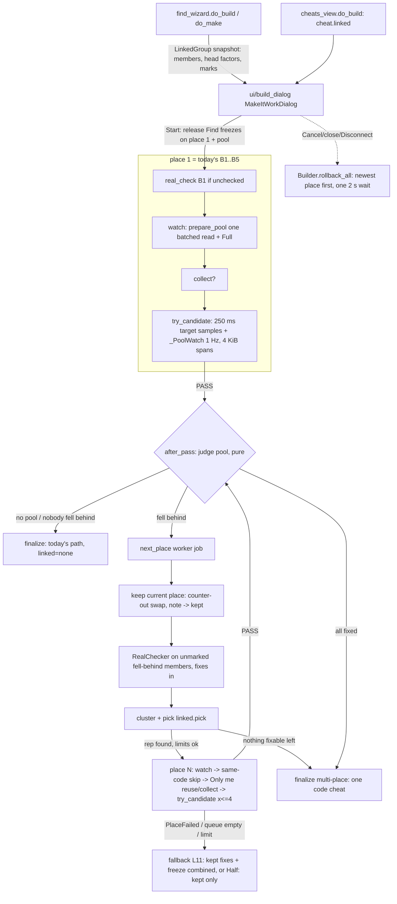

# Linked values in Make it work: design

Date: 2026-11-12. Spec: docs/spec-linked-values.md (L1 to L17). The OPEN items use their defaults: no trim, Full not editable on multi-place cheats, at most 3 places, L11 keeps the passed fixes and adds a freeze, and Make it work stays off on combined cheats. This extends docs/architecture-cheat-builder.md.

There is no new dependency, service or cost. Everything reuses existing pieces:
- `RealChecker` and its 4 KiB batched read
- `cave.find_cave` / `find_slot` with `extra_reserved`
- `Builder._keep` (the counter-out swap) and `_write_back`
- `combine` and `LiveCheats.turn_on`
- the `build_notes` JSON file

**Design rule for L17: when the pool is empty or absent, every console request, every sleep and the notes file are the same as today.** Every new branch sits behind `self.pool` being non-empty or `self._kept` being non-empty. The only visible difference is the `build_result` log line, which gains `places=1 linked=none` as the spec asks.

## Overview



The states extend today's, with the new part in brackets:

Watching -> ... -> Passed -> [AfterPass -> (Done) | Keeping -> LinkedCheck -> Picking -> Place N: Watching -> [Collecting] -> Testing -> Passed -> AfterPass ... | Fallback] -> Done.

Each new step is one `ctl.tasks.run` job, like today's steps. The only exception is `after_pass`, which is pure (no console) and runs on the UI thread between jobs.

Pool reads are added to the existing 250 ms test loop, on the worker thread. There is no new thread and no second socket user.

## (1) Data model

### New pure module `core/linked.py`

```python
POOL_MAX = 16             # L2, members not marked copy
MAX_PLACES = 3            # L10
MAX_LINKED_FIXES = 4      # L10, candidates per linked place
MAX_TESTS = 12            # L10, tests per build incl. place 1 and repeats
LINK_TOL = 0.02           # L2 start check, falls behind, cluster
POOL_EVERY_S = 0.75       # each span read at most this long after its last read
MAX_SPAN_READS_PER_TICK = 5
BEHIND_READINGS = 2       # "at least 1 s in a row" = 2 consecutive readings (>= 0.75 s apart)
UNKNOWN_END_S = 2.0       # a member with no readable reading in the last 2 s is unknown

@dataclass(frozen=True)
class PoolMember:
    address: int
    vtype: ValueType
    factor: float              # member = reference x factor (head-relative in a LinkedGroup,
                               # place-1-relative after pool_for / check_start)
    likely: bool               # grouping LIKELY
    mark: rc.Verdict | None    # Check which is real, None = not checked

@dataclass(frozen=True)
class LinkedGroup:             # in-memory snapshot of a Find group; never saved
    members: tuple[PoolMember, ...]   # group order (best first), factors vs group head

class Status(Enum): KEPT_UP = "kept up"; BEHIND = "fell behind"; UNKNOWN = "couldn't be read"; NOT_WATCHED = "not watched"

@dataclass(frozen=True)
class Reading: t: float; ref: float | int | None; value: float | int | None

@dataclass(frozen=True)
class Judged: member: PoolMember; status: Status; worst: float | int | None

@dataclass
class PoolRow:                 # one Advanced line (L15), updated after every judge
    member: PoolMember; status: Status; done: str = ""

def from_group(group: Group, verdicts: Mapping[rc.Key, rc.Result]) -> LinkedGroup | None
def pool_for(linked: LinkedGroup, place1: rc.Key,
             marks: Mapping[rc.Key, rc.Result]) -> tuple[list[PoolMember], list[PoolMember]]
    # (watched, copies) with factors rebased on place 1
def check_start(place1: rc.Target, v1, pool: Sequence[PoolMember],
                values: Mapping[rc.Key, float | int | None]
               ) -> tuple[list[PoolMember], list[tuple[PoolMember, str]]]   # (kept, dropped+reason)
def plan_spans(members: Sequence[PoolMember], ref: rc.Target) -> list[list[rc.Target]]
def judge_member(m: PoolMember, readings: Sequence[Reading], end_t: float) -> Judged
def clusters(behind: Sequence[PoolMember],
             readings: Mapping[rc.Key, Sequence[Reading]]) -> list[list[PoolMember]]
def pick(clusters: Sequence[Sequence[PoolMember]]) -> list[tuple[PoolMember, list[PoolMember]]]
def scaled_full(full1: float | int, k: float, vtype: ValueType) -> float | int
```

### `core/cheats.py`

There are two new in-memory fields, both `field(..., compare=False)`. Like `check_after_restart` and `carried`, they are never written to cheat files or `.cmproj`:
- `linked: LinkedGroup | None = None`. This is the pool of a session cheat made from a grouped Find row (L2). `combine` builds new `Cheat`s, so combined cheats have no pool.
- `places: int = 1`. Set by a multi-place Make it work result. cheats_view uses it only to show the tooltip "Make it work again to change Full."

### Cheat lines for a multi-place build (L13)

**All places fixed in code.** The result is one plain cheat, not combined: `template="lock"` and `locations` = place 1's lines, then place 2's, then place 3's. Each place contributes exactly what `_cheat` emits today: a routine line (on == off) plus a jump line per hooked writer, then the NOP lines.

The rest of the cheat:
- `name="<name>: <effect>"` (+ " (only me)")
- `places=N`
- `value_type=None`, `value_at=None`. Full can't be edited: the value cell is empty, read-only, and has the tooltip. This holds after a reload too, because nothing extra is saved.
- `check_after_restart` = any place used Only me by a field. `after_restart` is "Check after restart" in that case, else "Yes".

It can be saved to GoldHEN and CheatRunner files: these are only CODE_PATCH lines, which the writers already handle.

A single-place result is exactly today's `_cheat` output. That includes `value_at` for Always full.

**With a freeze (L11).** There are two inputs:
- `code = Cheat("<name>", <code lines as above>)`
- `hold = Cheat("<name> (place 2)", [Location(SESSION_ADDRESS, addr, data, data, vtype=vt)], freeze=True, value_type=vt)`

The result is `combine([code, hold], name="<name>: <effect>")`. Before combining, `loc.part="<name>"` is set on every code line. `_name_parts` then gives the code lines "<name>", "<name> (2)", and so on, and the freeze part stays "<name> (place 2)" (or "(place 3)").

This cheat is combined and session-only, so it is not written to cheat files (restart-combined AC-6), and Find it next time learns the moving part through the existing parts path (L14). It is switched on with `live.turn_on`. That rewrites the code lines with the same bytes once and starts the freezer; `mark_on` refuses freeze cheats.

### In-memory pool on session cheats

- `find_wizard.do_make`: if the row's `_group_of` has 2 or more members, `cheat.linked = linked.from_group(group, self.verdicts)`.
- `cheats_view.do_build` passes `pool=c.linked`. Rows without it have no pool.

### build_notes format (kept-not-saved fixes, L12)

```json
{"open": {title_id, version, pid, site_off, method, n, patches, rooms, time, "place": 2} | null,
 "kept": [{...same OpenNote fields..., "place": 1}],
 "crashed": [...unchanged...]}
```

- `OpenNote.place: int = 1`. `to_json` writes `"place"` only when it is greater than 1, so a no-pool file is byte-identical. `from_json` defaults it to 1.
- `"kept"` is optional. `_load` normalizes a missing or bad value to `[]`, so old files keep working. An older app ignores the key, which only loses the put back of kept places after an app crash.
- New API:
  - `keep_note()` moves `open` into `kept` in one atomic write. `open` must already hold the re-aimed sites from `_keep`.
  - `kept_notes() -> list[OpenNote]`
  - `clear_kept(places: Iterable[int] | None = None)`
  - `clear_all()`, meaning open and kept.
- `check_on_connect` first handles `open` exactly as today. Then it handles `kept`:
  - **Same pid.** Run `_put_back_sites` per note, newest place first. Then one `PUT_BACK_WAIT_S` wait. Then zero each note's rooms, only if all its sites are clean.
  - **Other pid, or no game.** Drop the kept notes silently with a log line. They are never marked crashed; only `open` is (L12).
  - **Hint.** If kept fixes were put back, the hint is "Fixes from last time were still in the game. They've been put back." The open note's own hint takes precedence when it has one.

### `.cmproj`

No change. The pool is never saved. A freeze-combined cheat that the player later teaches with Find it next time goes through the existing format-3 parts path, where code lines become fixed `code_patch` parts.

## (2) Component changes

| Module | Change | New or changed signatures |
|---|---|---|
| `core/linked.py` (new) | Pure pool logic | see (1) |
| `core/real_check.py` | `_read_all` split into two module functions. `RealChecker._read_all` loops over them, so the requests are identical. | `spans(targets, span=READ_SPAN) -> list[list[Target]]`; `read_span(client, pid, ts: list[Target]) -> dict[Key, bytes]` (one read, falls back to one read per member on `ReadFailed`) |
| `core/cheats.py` | 2 in-memory fields | `Cheat.linked`, `Cheat.places` |
| `core/build_notes.py` | `place`, `kept` list, connect handling | `keep_note()`, `kept_notes()`, `clear_kept(places=None)`, `clear_all()` |
| `core/builder.py` | Pool prep, `_PoolWatch`, places loop, `rollback_all`, fallback, multi-place finalize | see (3) |
| `ui/build_dialog.py` | New kw `pool`; release pool freezes; steps `after_pass` / `next_place` / `fallback`; place hints; Advanced pool rows; `_end` puts back kept places | `MakeItWorkDialog(..., pool: LinkedGroup \| None = None)` |
| `ui/find_wizard.py` | `do_build` passes `pool=linked.from_group(group, self.verdicts)` for every group. `group=targets` stays as today (only unchecked groups), so B1 is unchanged. `do_make` sets `cheat.linked`. | none |
| `ui/cheats_view.py` | `do_build` passes `pool=c.linked`; value cell tooltip when `c.places > 1` | none |
| `ui/hints.py` | New strings: L1, L6, L11 (two), L13 done, L15 done texts, `BUILD_ADV_POOL` | none |

## (3) Builder

### New attributes

All are empty or None when there is no pool:

```python
self.pool: list[PoolMember]            # watched members after check_start
self.copies: list[PoolMember]          # marked copy: listed, judged if watched, never fixed
self.pool_rows: dict[int, PoolRow]     # by address, for Advanced
self.pool_released = 0                 # set by the dialog
self.place = 1
self.place_member: PoolMember | None   # None for place 1
self.places_total = 1                  # for "Place N of M"
self.tests_total = 0                   # counts every try_candidate (L10 12-test limit)
self._kept: list[_Place]               # passed places, swapped to their kept routine, not yet a cheat
self._kept_reserved: list[tuple[int, int]]  # module (start, end) of kept rooms + slots
self._fixed_sites: set[int]            # writer addresses fixed by kept places
self.linked_result = "none"            # none | fixed | freeze | partial
```

New `_Place` (dataclass) holds what a kept place needs at finalize and rollback:

```python
n, address, vtype, full, member, filter, by_class, player_obj, other_objs,
inst: _Installed, saved: list[tuple[_Room, bytes, bytes]], start_value
```

`_Installed` gets `pool: PoolData | None = None` (the readings of its test) and `place: int = 1`.

### New and changed methods

```python
Builder.__init__(..., pool: LinkedGroup | None = None)     # default keeps today's behaviour

def watch(cancel)  # place 1 + pool: _prepare_pool() right after reading Full, before find_writers.
                   # place > 1: writers at a _fixed_sites address or inside a kept room
                   #   -> Skipped(w, SAME_CODE "it's the same code as an earlier fix");
                   #   BuildFailed -> PlaceFailed.
def _prepare_pool() -> None   # one batched read (place 1 + members); check_start; factors = Start
                              # ratios; Full_m = scaled_full; log build_pool
def after_pass() -> LinkedPlan                 # pure: judge inst.pool, update pool_rows,
                                               # log build_linked_check
def next_place(cancel) -> NextPlace            # worker: _keep_place(); RealChecker on unmarked
                                               # fell-behind; clusters/pick; limits; _begin_place(m)
def reuse_filter() -> bool                     # L7: same object start as a kept place -> copy its
                                               # filter, others, _only_where_learned(disp)
def fallback(cancel) -> BuildResult            # L11
def finalize(cancel) -> BuildResult            # no _kept: today's code unchanged; else multi-place
def rollback_all(reason, *, wait=None) -> Rollback
def close(wait)                                # now calls rollback_all (== rollback when _kept empty)
@property has_kept -> bool
class PlaceFailed(BuildFailed)                 # raised only for place > 1: dialog goes to fallback
```

`LinkedPlan(done: bool, behind: list[PoolMember], hint: str)` and `NextPlace(place: int | None, total: int, member: PoolMember | None, fallback_reason: str | None)` are small frozen dataclasses.

### Pool preparation (L2)

`linked.pool_for` runs these steps in order:
1. Drop place 1 itself.
2. Copies go into a separate list.
3. Drop any member sharing a byte with place 1 or with a member already taken.
4. Rebase factors: `k = f_m / f_place1`. Drop `k` that is NaN or ≤ 0, with reason "factor".
5. Take the first 16 watched members in group order.

Marks come from the snapshot overlaid with `self.real_results` from B1, which is fresher.

`check_start` at Start, after the dialog has released the Find freezes (`find:{addr}`) on place 1 and every member:
- Read place 1 and the members in `rc.spans` batches. Place 1 is read in the same request when it is within 4 KiB of them; otherwise in the request just before.
- `e = k_group × v1`.
- Keep a member if `|v_m − e| ≤ max(0.02·|e|, 1 if int else 1e-6)`. Otherwise drop it with "not linked any more", or "couldn't be read" if the read failed.
- For kept members, `k := v_m / v1` (the Start ratio, per the spec's definition of Factor). If `v1 == 0`, keep `k_group`.
- Log `action=build_pool members=N dropped=N released=N`.
- If no watched member is left, the pool is empty from here on and the build is exactly today's.

Always full (L8): `full_m = scaled_full(full_1, k, vtype)`, where `full_1` is the typed Full or the one read now. Decimals are `vtype.decode(vtype.encode(x))`; whole numbers are `round(x)` clamped to the type.

### Fell-behind judge (L3), precise

For each watched member `m` that is not a fixed place, with readings `(t, ref, value)`:
- `ref` is place 1's value at that tick. During place 1's test it is the tick's target `Sample.value`. In later tests place 1 is read with the tick's spans; it is added to `plan_spans` as the reference target.
- A reading is **usable** when `value` and `ref` are both finite.
- `e = k·ref`, `gap = e − value`.
- **Behind at a reading:**
  - Decimals: `gap > 0.02·|e|`.
  - Whole numbers: `gap > 1`.
- **UNKNOWN** if there are fewer than 2 usable readings, or none with `t ≥ end_t − 2.0`. An unknown member is not fixed.
- **BEHIND** if the last usable reading is behind ("at the end of the test"), or 2 consecutive usable readings are behind. An unreadable reading breaks the run. With ≥ 0.75 s spacing, 2 consecutive readings means behind for "at least 1 s in a row".
- Otherwise **KEPT_UP**.
- `worst` = the member's value at the largest gap. It is logged as `action=build_linked_check n=<place> member=<addr> k=<k> result=kept_up|behind|unknown worst=<v>`.

This works the same for all three effects:
- **Never goes down:** place 1 holds, so `e` holds, and a member that drops is behind.
- **Always full:** `e = k·Full`.
- **Half damage:** place 1 loses half, so `e` drops by half, and a member losing the full amount drifts below `e` by half a hit. That exceeds 2% for any hit over 4% of the value.

Copies that are watched are judged too, but only for display.

### Clustering (L5), precise

The input is the members that fell behind in this test, copies included, in pool order.

**Pairing.** For each pair (a, b), pair each reading of `a` with the reading of `b` nearest in time, within 0.5 s. Members in the same 4 KiB span are read in the same request, so their gap is 0. Drop a pair if either member's value differs between its previous and next readings: that is a transitional reading taken mid-hit.

**Same ratio.** `r = a/b` over the remaining pairs, with `r_end` the last pair's ratio. a and b have the same ratio if there is at least 1 pair and every pair has `|r − r_end| ≤ 0.02·|r_end|`. A zero on one side breaks the link; zero on both sides is skipped.

**Building clusters.** Go through the members in order. A member joins the first cluster whose head (first member) has the same ratio with it. Otherwise it starts a new cluster. As in `grouping`, there are no chains.

**Pick** (`linked.pick`):
- Eligible = mark is REAL or KEPT (after the L4 check). COPY, FAILED and UNKNOWN members are never fixed (L4).
- Sort key for a member: `(mark is not REAL, not likely, −len(its cluster), address)`.
- Each cluster's representative is its eligible member with the smallest key. A cluster with no eligible member gets "copy: never touched" or "couldn't be checked" in Advanced, and it does not count as "left to fix" for L9.
- Clusters are ordered by their representative's key. The next place is the first cluster's representative.
- Log `action=build_linked_pick place=N member=<addr> mark=<real|kept> cluster=<size> reason=...`.

**After a place passes.** `after_pass` judges again with every fix in. Members that now keep up get `done = "not needed: it kept up after place N was fixed"`. Any eligible or unmarked member still behind starts the next round of `next_place`.

### L4 check inside `next_place`

Fell-behind members with `mark is None` form one `rc.Target` group. They are run through `rc.RealChecker(client, pid, [group], wait=self.sleep)` after the current place has been kept, so its fix is in. The results update the marks and `real_results`. The checker's own put back applies. A `ConnectionLost` raises and goes to `_failed`, which calls `close()`.

### Limits (L10) in `next_place` / `next_candidate`

In this order:
1. `place == MAX_PLACES` → fallback with reason `LIMIT`.
2. `tests_total ≥ MAX_TESTS` → `LIMIT`.
3. A linked place's queue is `candidates(eligible, limit=MAX_LINKED_FIXES)`.
4. When `next_candidate()` would start test 13, it returns None and sets `self.limit_hit`.

The LIMIT reason text is "This value is kept in more places than the app can fix on its own." Place 1 is naturally at most 12 tests (6 candidates × 1 repeat), so this check never fires on the no-pool path.

### `_begin_place(m)`

Steps:
1. `place += 1`.
2. Reset the per-place fields to fresh values: address, vtype, full, writers, eligible, skipped, queue, tried, filter, by_class, others, collect_tries, `_repeat`, `_repeated`, `_answers`, `_pending`.
3. If `m.vtype not in cv.EFFECT_TYPES`, raise `PlaceFailed(cv.UNSUPPORTED_TYPE)`, which leads to L11.
4. Log `build_start` as today, with the new address.

All existing methods (`watch`, `collect`, `try_candidate`, `_prepare`, `_live_test`) work on "the current place" unchanged. That is why the no-pool path does not move.

### Per-place installed and passed: `_keep_place()`

This runs under `self._op`:
1. `inst = self._passed`.
2. `saved = self._keep(inst)`, exactly today's swap: saved routine into the second room, re-aim the jump, 2 s wait, zero the test room and slot, re-open the note with the re-aimed sites.
3. `notes.keep_note()`.
4. `self._kept.append(_Place(...))`.
5. Under `_lock`: `_installed = _passed = None`.
6. Add the place's rooms (`(test_room, 2*CAVE_ROOM)`) and slot to `_kept_reserved`, as module offsets (start, end).
7. Add the writer addresses to `_fixed_sites`.

`_prepare` then calls:
- `cv.find_cave(..., extra_reserved=self.extra_reserved + self._kept_reserved)`
- `cv.find_slot(self.session, self._kept_reserved)`

Both lists are empty for place 1, so place 1 makes the same calls as today. Later places get their own rooms and their own counter slot (L6).

`_installed` still means only "the fix under test", and its note is the only `open` note. `_passed` still means "the current place passed".

### Rollback order (L12)

- `rollback(reason)` is today's: only the fix under test. It is still used after every failed candidate, so kept places stay in during a linked place's retries.
- `rollback_all(reason, wait=None)`:
  1. Acquire `_op` (same timeout semantics as today).
  2. Under `_lock`, pop `_installed` and `_kept`.
  3. List = `[installed] + reversed(kept)`, newest place first.
  4. `_write_back_many(list)`: write the originals at every site (per place, `reversed(sites)`), then **one** `sleep(PUT_BACK_WAIT_S)`, then zero every place's rooms and slot (using the `_slot_ours` check). All jumps are out within one round of writes, which meets C22f's "within 2 s".
  5. On success, `notes.clear_all()` and one `build_rollback n= place= restored=True` line per place.
  6. On `CheatMakerError`, `NOT_RESTORED` and `not_restored=True`. The notes stay for the next connect.

  For a one-element list, `_write_back_many` makes exactly today's `_write_back` calls.
- `close()` calls `rollback_all`.
- Every worker step of a linked place (`next_place`, a place > 1's `watch` / `collect` / `try_candidate` cancel path, `fallback`) calls `rollback_all("cancelled")` in the worker before returning CANCELLED or raising `ScanCancelled`. So Cancel never waits 2 s on the UI thread (B6 design).
- **Game gone** (`_lost` with `game_gone`): today's crash mark for the fix under test only. Then `notes.clear_kept()` and `self._kept.clear()`, because those fixes died with the process and nothing is written to a dead pid.
- **PS button / slow read** (`_lost` without `game_gone`): today's put back of the fix under test. Kept places stay in.
- **`NOT_RESTORED` anywhere:** stop and use the B6 wording. Kept places are not touched (L12 "nothing more is tried").

### Finalize and fallback

**`finalize()` with `_kept` non-empty:**
1. Under `_op`, `_keep(current passed)`.
2. Build the multi-place cheat from (1).
3. `notes.clear_all()`.
4. `live.mark_on`.
5. `linked_result = "fixed"`. Hint: "Done. <name> is held in N places by one cheat."

**`fallback(reason)` (L11).** The current place has nothing installed: its fix failed, or the place never got a test.
- **Never goes down / Always full:**
  - Build the code cheat from `_kept`.
  - Build the hold for the current place's member. Never goes down holds `start_value`, the value when its last test started, or at its watch if no test ran. Always full holds `full_m`.
  - `combine`, then `notes.clear_all()`, then `live.turn_on(combined)`.
  - `linked_result = "freeze"`; after_restart is "This session only".
- **Half damage:** a code cheat from `_kept` only, `linked_result = "partial"`, and the half-damage warning hint.
- Log `action=build_linked_result place=N result=fallback_freeze|limit|fail`.
- Only the failing place's member is held. Other clusters still behind are listed as not fixed and make `linked=partial`. There is no extra test (L9). Freeze places count toward `MAX_PLACES`.

**`build_result`** gains `places=N linked=<linked_result>`. `log_end` gains the same fields; with no pool it shows `places=1 linked=none`.

## (4) Threading and timing

- Everything runs on the step's worker thread, as today. `_PoolWatch` is a helper like `_AliveCheck`: one is created per test in `_live_test` when `self.pool` is non-empty, and it is None otherwise.
- **Schedule.** `plan_spans` groups the watched members (copies last) plus the reference into `rc.spans` (4 KiB). Copy-only spans beyond 16 spans are `NOT_WATCHED`. Each span gets a due time staggered over the first second: `t0 + i·POOL_EVERY_S/n`. On each 250 ms tick, after `_sample`, the watch reads the overdue spans, at most `MAX_SPAN_READS_PER_TICK`, oldest due first, and sets each one's `due += POOL_EVERY_S` (or `now + POOL_EVERY_S` if it is late).
- **Read failures.** `ReadFailed` on a span is caught inside the watch: those members get `value=None`, and after 2 failures the span is dead for the rest of the test. This matters because the loop's existing `except (ConnectionLost, ReadFailed)` would otherwise call an unloaded pool member "game not alive". `ConnectionLost` still propagates, leading to the Lost path.
- **Keeping target sampling intact.** With a pool, the tick's sleep becomes `max(0, POLL_S − pw.last_cost)`, where `last_cost` is the time the previous tick's pool reads took, measured with `self.clock`. Pool reads take time out of the sleep instead of stretching the tick, so the target's samples per 20 s stay within the 10% budget while `last_cost < POLL_S`. At about 36 ms per request, a worst case of 5 + 1 reads is about 220 ms. Without a pool, `sleep(POLL_S)` is unchanged.
- **Timing log.** Each test logs `action=build_linked_reads place=N spans=S reads=R avg_ms=X late=L` so C22a can confirm the console really keeps up.
- **Watch is untouched.** Neither watches nor Collect read the pool.

## (5) Dialog flow changes (`ui/build_dialog.py`)

- `_release()` runs only at place 1. In addition to today's work, it unfreezes `find:{addr}` for every pool member in `ctl.frozen_addresses` and sets `b.pool_released`.
- `_tried` on PASS:
  - `if not b.pool and not b.has_kept`: today's `finalize`.
  - Else `plan = b.after_pass()`. If `plan.done`, finalize. Otherwise show the L1 hint (first time only) and `_run(b.next_place, self._placed)`.
- `_placed(np)`:
  - `np.fallback_reason`: `_run(b.fallback, self._finished)`.
  - Otherwise: progress hint "Place N of M: play and make it change (take a hit) within 30 seconds.", `_watch()`, and then in `_watched`, if Only me and `not b.reuse_filter()`, `_collect`.
- `_next`: when the queue is empty and `b.place > 1`, go to `fallback` instead of `BUILD_NONE_WORKED`.
- `_failed`: a `bd.PlaceFailed` goes to `fallback`. Everything else is as today.
- The test hint for place > 1 is "Testing fix N of M for place P: keep playing and take a hit.", built in `_live_test` only when `place > 1`.
- `_end` without a result: `if b.has_kept: self._close_builder()`. That is the between-steps Cancel; no-pool builds never have kept places.
- Advanced: after each `after_pass` and at the end, one line per `pool_rows` entry: address, type, `x<k>`, mark (real / kept / copy / not checked), status, done.
- `_finished` chooses the Done hint from `res.linked`: today's text for `none`; L13 for `fixed`; the L11 freeze text for `freeze`; the L11 half-damage text for `partial` with Half damage.

## Risks

1. **Slow console reads.** If one request takes about 60 ms or more, 6 pool reads per tick exceed 250 ms. Samples then drop by more than 10% and a span can go 1.4 s between reads. The judge uses timestamps and consecutive readings, so it stays correct, but L3's numbers would be missed. The `build_linked_reads` log on C22a shows this. The fallback is to lower `MAX_SPAN_READS_PER_TICK` to 3.
2. **Cross-tick pairing in clusters.** Members more than 4 KiB apart are read up to about 0.5 s apart. Readings taken mid-hit are dropped, but a fast-draining value (poison ticks) could split one cluster into two. The cost would be one extra place tried, which keeps up and becomes "not needed". Never a wrong fix.
3. **One-reading "at the end" rule.** A copy updated one frame late at the final reading could read as behind. The ref is read in the same request when it is within 4 KiB. Otherwise the gap is milliseconds. If it happens, the cost is an extra L4 check (which marks it a copy) or an extra place.
4. **The freeze-combined cheat rewrites its code lines on every freezer tick.** This is existing Combine behaviour, about 270 bytes per place × 10/s, with identical bytes so nothing changes in the game. It is accepted to keep L17 (Combine unchanged).
5. **The same instruction writes both places.** Place 2's watch can catch place 1's routine, which holds a copy of the game's writer, writing place 2. Writers inside kept rooms or at fixed sites are skipped as "same code". If the only writer is shared, the result is L11's freeze.
6. **Pool members held by other My cheats rows** (not Find freezes) are not released. They keep up and are never fixed. Released freezes are not turned back on after the build, as with today's `_release`.
7. **An older app that reads a newer notes file** ignores `kept`. After an app crash, kept fixes in the same process aren't put back until the game restarts.
8. **3 places × 2 rooms.** Each place uses `2·CAVE_ROOM·hooks` of cave space, so a small cave may refuse place 3. `_prepare` fails, the place fails, and L11 applies.
9. **Kept places only live in memory until Done.** The `kept` notes cover the app dying. A PS5 crash takes everything with the game, so nothing needs putting back.

## Implementation steps

Each step is a small PR or commit, testable with FakeConsole, a fake clock and a sync TaskRunner.

1. **Golden regression first.**
   - Change: none.
   - New test `tests/unit/test_builder_golden.py`: record `FakeConsole.writes`, the read requests (via `game_ticks` hook order) and the `sleep` calls for today's builds: simple Never goes down, Always full, Half, Only me, plus fail, cancel and lost paths. Record the `build_notes.json` contents at each step. Every later step must keep this passing.
2. **`real_check.spans` / `read_span` extraction.**
   - Test: `test_real_check` unchanged and green.
   - New tests: spans split at 4 KiB; a `ReadFailed` span falls back per member.
3. **`core/linked.py` pure**, in new `tests/unit/test_linked_pure.py`.
   - `from_group` / `pool_for`: rebase, copies split, overlap, cap 16, k ≤ 0 dropped.
   - `check_start`: 2% rule, int slack of 1, `v1=0`.
   - `judge_member`, for all three effects with Returnal-shaped series:
     - the fraction behind
     - the percent following the fraction
     - copies keeping up
     - unknown cases
     - last-reading-only and 2-consecutive cases
     - int `gap > 1`
   - `clusters`: fraction plus percent together, a far copy apart, transitional pairs ignored.
   - `pick` ordering: real before kept, likely, size, address; all-copy clusters skipped.
   - `scaled_full`.
4. **`Cheat.linked` / `places`.**
   - Test that equality and file round-trips ignore them, and that `combine` drops `linked`.
   - Also the cheats_view tooltip; this test goes in `tests/ui`.
5. **build_notes.**
   - `place` is omitted when 1 (byte-identical file).
   - `keep_note` / `clear_kept` / `clear_all`.
   - `check_on_connect`: kept put back in the same pid, newest first, one wait; kept dropped and not marked in another pid; open still marked.
   - An old file without `kept` loads.
   - Extend `tests/unit/test_build_notes.py`.
6. **fakegame extension** (`tests/fakegame.py`).
   - A second object with a fraction and its own `vmovss` writer.
   - A percent copy recalculated from the fraction on every `game_ticks` call.
   - Two HUD copies recalculated from health.
   - A latency hook that advances the fake clock by 36 ms per read.
7. **Pool prep + `_PoolWatch`** (no linked step yet: `after_pass` is not used).
   - Tests:
     - `build_pool` log and drops after the game changed
     - releases
     - every member read at least once per second under latency
     - target samples ≥ 90% of a no-pool run (C22-style count)
     - pool `ReadFailed` gives unknown, not Lost
     - golden still green
8. **`after_pass` → finalize with `linked=none`.**
   - Test: a pool where everyone keeps up gives one test, a cheat identical to the no-pool cheat, and `places=1 linked=none` (C22d / C22e in fake).
9. **`_keep_place` + `rollback_all` + kept notes.**
   - Tests for 2 and 3 places on fail, Cancel (worker), close from another thread, Disconnect, lost with the game gone, and NOT_RESTORED. Module bytes must match the snapshot.
   - The cancel test asserts a single 2 s wait.
   - `_kept_reserved` gives distinct rooms and slot (assert no overlap with place 1 or open cheats).
10. **`next_place`: L4 check, cluster pick, `_begin_place`, Full scaling, same-code skip, limits, `PlaceFailed`.**
    - Flow test in `tests/unit/test_builder_flow.py` with Returnal-shaped data, Never goes down: two places pass, the percent is "not needed", copies are untouched, hints name the places.
    - Always full: the fraction's Full is 1.0 within 0.5%.
    - Half damage: both places halve.
    - Limit tests: 4 fixes per place, 12 tests, 3 places.
11. **Only me per place.**
    - Same object start reuses the filter and runs no second Collect. Another object runs Collect once.
    - CANT_TELL_APART gives L11.
    - The enemies check runs per place.
12. **`finalize` multi-place + `fallback`.**
    - Line order per place; `after_restart` Yes or Check after restart; saveable.
    - Freeze-combined part names; session-only; not saveable; `turn_on` starts the freezer.
    - Half damage: kept only plus the warning.
    - Crash note test: disconnect during place 2's test marks only place 2's writer/method, and kept notes are handled as in step 5.
13. **UI wiring** in `ui/build_dialog.py`, `find_wizard.py`, `cheats_view.py` and `hints.py`. Tests in `tests/ui/test_build_ui.py`:
    - A simple game shows no extra step or question.
    - A two-place flow shows the Advanced pool rows.
    - Cancel during place 2 puts both back and shows "Your game is unchanged."
    - Make it work from a My cheats row made from a grouped Find row uses `cheat.linked`; other rows have no pool.
    - `do_build` passes the pool for checked groups too, while `group=` stays as today.
14. **Docs.**
    - user-guide (Make it work: places, the freeze fallback, Full read-only)
    - console-tests C22a to C22h
    - mark B7 replaced in spec-cheat-builder's cut list

**Cut order if too big:** Only me on linked places (Collect per place) first, then the L4 check (treat unmarked as fixable). Steps 1, 5, 7 and 9 must not be cut: the golden regression, the notes, the sampling budget and the rollback.

## Decisions the spec leaves open (made here, flag to Kein if needed)
- **The "1 s in a row" rule** is read as 2 consecutive readings at least 0.75 s apart.
- **Whole numbers get a slack of 1** in the L2 start check, besides 2%, so a rounded small int isn't dropped.
- **Copies** are watched only within the 16-span budget; any beyond it show "not watched".
- **L11 holds only the failing place's member.** It doesn't also freeze other still-behind clusters, and freeze places count toward the 3-place limit.
- **Other My cheats rows freezing a pool member are not released.** Only Find freezes and the source row are.
