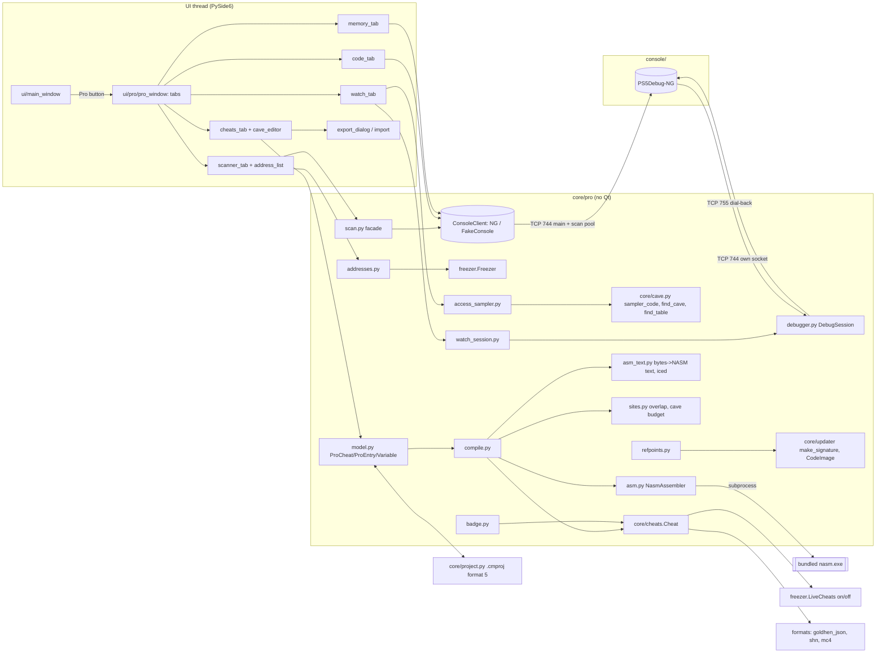

# Cheat Maker Pro: architecture

Date: 2026-11-21. Inputs: `cheat-maker-spec-pro.md` (spec), `cheat-maker-pro-review.md` (review), `cheat-maker-pro-draft.md`, and the code on main (`src/cheatmaker/...`). I followed the style of `docs/architecture-trace.md`. Every [OPEN] item uses the spec's default (R1 scope). This document only describes the design; it contains no code.

## Key decisions for Kein

1. **Assembler: bundle NASM 3.02 (BSD-2) and run it as a separate program. Don't use Keystone.** I checked Keystone's licence. It is GPLv2 *without* "or later", so its code can't simply go into our GPL-3.0 app. It does have a FOSS client exception that lists GPL-3.0, but one of its conditions ("no other GPL work in the derivative") makes it unclear whether it covers an app that is itself GPL. Its last release was 0.9.2 in June 2020. I found no pip-installable assembler that is both maintained and GPL-3-compatible: iced-x86 can't read assembly text, and the PyPI package called `nasm` is an unrelated 6502 tool. → **I agree with the review and the spec (NASM).**
2. **mc4 encryption: copy ReaperPy's pure-Python `aes_cbc.py` (MIT, about 160 lines, no imports) and credit it, instead of adding `cryptography`.** `cryptography` is fine licence-wise (Apache-2.0 OR BSD-3-Clause, abi3 Windows wheels). But it adds a native dependency to encrypt a file of a few KB with a key that is public anyway. We test the copied code against the NIST SP 800-38A AES-256-CBC vectors. The public key goes in `formats/mc4.py` with a comment saying it is the key every mc4 tool uses; it protects nothing. → **This differs slightly from the spec's default (`cryptography`); the spec does allow "or equivalent".**
3. **Pro cheats are a source layer that compiles to the existing `Cheat` model.** One `Cheat` list, one `LiveCheats`, and one set of exporters. `.cmproj` format 5 stores each Pro cheat's source *and* its compiled lines, so a project loads, turns on and exports with no assembler on the PC. → I agree with the review [12]/[13] and add this rule.
4. **Debugger: a new `DebugSession` on its own NG connection.** It handles the back channel on port 755 (bound before attach), keep-alive and the 4 watch slots. The guided `watch()` stays exactly as it is in R1 because it is the path proven on the console (C4). Only one debugger user at a time (`Session.debug_owner`). R3 adds breakpoints, step and registers to the same class, using the command table ReaperPy uses (credited).
5. **Order of work: start the R1 slices that don't need the debugger now, in parallel with the S-P0 ReaperPy trial.** Only PR-3 waits for S-P1/S-P2. → **This disagrees with the review's "B now, then A".** The scanner, code and memory views, cave editor, export and import don't depend on any unproven NG feature, so waiting a week for them gains nothing.
6. **Escape cheat names the same way for shn and mc4** (replace `& < > "` with `+ ( ) '`, as ReaperPy does for mc4). Otherwise AC-12.2 (decrypted mc4 == shn, byte for byte) and AC-12.4 (names with those characters) conflict. S-P8 checks whether CheatRunner handles XML escapes properly; if it does, both formats switch to `quoteattr`. → **This is a spec conflict I found.** Smaller points are in "Spec refinements" below.

---

## Goal & assumptions

Add a Pro window to Cheat Maker for doing every step by hand: scan, find the instruction, read code and memory, and write NOP / byte / code-cave cheats in assembly with constant variables and AOB reference points. Everything that can run with the PC off must export to `.json`, `.shn` or `.mc4` files that CheatRunner loads.

Assumptions:
- Scale: one user, one PS5 (fw 13.60, PS5Debug-NG ≥ 1.3.2), one game at a time. A project holds a few dozen cheats. Watch sessions last up to 60 s / 500 hits.
- Windows desktop, Python 3.12 + PySide6, GPL-3.0-only. No server, no hosted service, $0 budget.
- Guided mode is unchanged. Pro reuses `Session`, `Controller`, `TaskRunner`, `Freezer`/`LiveCheats`, `cave.py`, `locker.py`, `updater.py`, `formats/*` and FakeConsole.
- R1 only (spec §2). The design shows where R2 and R3 plug in, but doesn't build them.
- The app's address list is not saved in R1, because the spec doesn't ask for it (heap addresses move every run anyway). Cheats are saved.

## Architecture overview



How it works:
- **The Pro window is a second view on the same `Controller` and `Session`.** The tabs call `core/pro/*` services on the existing `TaskRunner`. No Pro tab opens a new connection except the debugger, and only when a watch starts (AC-1.1).
- **A Pro cheat is source.** `compile.py` turns it into an ordinary `Cheat`: cave line(s) plus the jump line, with `value_at` for one variable. The guided code paths (`LiveCheats`, export, Bring them over, cheats view) therefore work on Pro cheats unchanged. Pro adds the safety rules for turning cheats on and off (AC-8.4 to 8.8) in one place.
- **`asm.py` is the only place that knows about NASM.** It wraps the source in a generated header, runs `nasm.exe -f bin`, and returns bytes, a symbol map and line errors. `asm_text.py` goes the other way: bytes to NASM text with iced-x86's NASM formatter. Code view text and editor text therefore use one syntax and copy-paste between them works.
- **`DebugSession` owns everything about the debugger**: its socket, the 755 listener, keep-alive, slots and stop events. `watch_session.py` is the PR-3 logic on top: grouping by instruction, limits and live counts. It is tested against a `FakeDebugger`.
- **The badge (`CheatRunner` or `PC only`) is a pure function of the compiled `Cheat`.** Export only takes CheatRunner-badged cheats and lists the rest with their reasons.

## Component choices

| Concern | Choice | Licence / Cost | Why | Alternatives considered |
|---|---|---|---|---|
| Language / UI | Python 3.12 + PySide6 ≥ 6.7 (existing) | PSF / LGPL-3.0, free | Already the app's stack | — |
| Disassembly, encoding, text formatting | **iced-x86 ≥ 1.21** (existing), `Formatter(FormatterSyntax.NASM)` | MIT, free | Already decodes and encodes everywhere. Its NASM formatter output is what NASM reads back | Capstone 5.0.9 (BSD-3-Clause, maintained, Windows wheels): a second disassembler that adds nothing. Not used |
| Assembler (text to bytes) | **NASM 3.02** (2026-06-29), `nasm.exe` bundled, run with `subprocess` (`-f bin`, `[map symbols]`) | BSD-2-Clause, free. Binary redistribution needs the copyright notice and disclaimer in the docs | Mature, maintained, permissive licence. Running it as a separate program keeps any licence question out of our code. A small cave assembles in tens of ms, well inside AC-8.1's 0.5 s (measure in slice 5) | Keystone 0.9.2 (GPLv2-only + FOSS exception; unclear for a GPL-3 app; inactive since 2020). llvm-mc.exe (Apache-2.0 WITH LLVM-exception; same syntax as ReaperPy, but tens of MB and no standalone release). fasm/fasmg (tiny, different syntax). Our own parser on iced (most work, gaps in coverage) |
| Paste compatibility with Reaper/ReaperPy/Capstone text | ~20-line dialect shim in `asm.py`: drop `ptr`, map `jmp OriginReturn` to `jmp return` | own code | ReaperPy uses Keystone syntax (`dword ptr`), which NASM rejects | Requiring users to edit the text by hand |
| mc4 AES-256-CBC + PKCS#7 + base64 | **`formats/_aes.py` copied from ReaperPy `aes_cbc.py`** + stdlib `base64` | MIT (keep its notice), free, 0 dependencies | About 160 lines, FIPS-197, both directions. We add NIST known-answer tests | `cryptography` 50.0.2 (Apache-2.0 OR BSD-3-Clause; abi3 Windows wheels): a good fallback if the copy ever gives trouble. `pycryptodome` (BSD): no gain |
| Debugger protocol | New `console/debugger.py`. Command IDs and layouts match our `ps5debug_ng.py` and ReaperPy `ps5_ext.py` (table below) | own code, credit ReaperPy (MIT) in NOTICE | One owner for port 755, keep-alive and slots | Extending `Ps5DebugNgClient.watch()`: it is a one-shot design and would put a long session on the shared main socket |
| Cave placement and sampler | `cave.find_cave`, `find_table`, `sampler_code`, `hook_span`, `jmp_patch`, `collect_objects` (existing) | own code | Already proven by Lock it and Player only | — |
| Reference points | `updater.make_signature`, `CodeImage.find`, `update_file` (existing) | own code | Same rules as Bring them over | ReaperPy's AOB module |
| Persistence | `.cmproj` **format 5** (`core/project.py`) | own code | One file per title and version (review [13] A) | A separate `.cmpro` file, `.reapproj` (R2 import only) |
| Freeze | `freezer.Freezer` (key `pro:{addr:x}`) | own code | 10 Hz bulk writes already exist (AC-2.3) | — |
| Packaging | PyInstaller ≥ 6 (already in `dev`). A new `cheatmaker.spec` adds `vendor/nasm/nasm.exe` and the licence files | GPL-2.0 with bootloader exception, free | The repo has no Windows build spec yet. This adds one | Nuitka |
| CI | GitHub Actions `windows-latest` (existing) + `tools/fetch_nasm.py` (pinned URL and SHA-256) | free for public repos | Assembler tests run in CI, not only on a dev PC | `choco install nasm` (version not pinned) |
| Logging | `logs.py` (existing), `action=pro_*` lines | own code | Spec §7 | — |

### NG debugger commands (for R1 watch sessions and the R3 debugger)

These come from our `ps5debug_ng.py` (PROTOCOL.md v1.3.0) and ReaperPy `ps5_ext.py`. Where both have a command, they agree. Request header: `<III` magic `0xFFAABBCC`, cmd, body length.

| Cmd | ID | Body | Reply | Used in |
|---|---|---|---|---|
| DEBUG_ATTACH | 0xBDBB0001 | `<I` pid | status (30 s) | R1 |
| DEBUG_DETACH | 0xBDBB0002 | — | status | R1 |
| DEBUG_SET_BREAKPOINT | 0xBDBB0003 | `<IIQ` index, enabled, addr (max 30; ReaperPy keeps 28 and 29 for run-to) | status | R3 |
| DEBUG_SET_WATCHPOINT | 0xBDBB0004 | `<IIIIQ` index 0-3, enabled, len code {1:0, 2:1, 4:3, 8:2}, breaktype {exec 0, write 1, rw 3}, addr | status | R1 |
| DEBUG_GET_THREAD_LIST | 0xBDBB0005 | — | status, u32 n, n×`<I` lwpid | R3 |
| DEBUG_SUSPEND / RESUME_THREAD | 0xBDBB0006 / 0007 | `<I` lwpid | status | R3 |
| DEBUG_GETREGS / SETREGS | 0xBDBB0008 / 0009 | `<I` lwpid / `<II` lwpid, 176 then 176 bytes | 176-byte `struct reg` (`<15QIHHIHH5Q`) | R3 |
| DEBUG_GETDBREGS / SETDBREGS | 0xBDBB000C / 000D | — | 128 bytes | R3 (optional) |
| DEBUG_CONTINUE | 0xBDBB0010 | `<I` action: 0 resume, 1 stop (SIGSTOP, "halt"), 2 kill | status | R1 (0), R3 (1) |
| DEBUG_THREAD_INFO | 0xBDBB0011 | `<I` lwpid | 40 bytes: `<II` tid, priority, name[8:40] | R3 |
| DEBUG_STEP / STEP_THREAD | 0xBDBB0012 / 0013 | — / `<I` lwpid | status | R3 |

The **interrupt packet** on port 755 is 0x4A0 bytes:
- `<II` lwpid, status at 0, and the thread name at [8:48];
- `struct reg` at 0x30;
- `savefpu` (832 bytes) at 0xE0. If it uses the standard FXSAVE layout, XMM0-15 are at 0x180-0x27F. Unverified until S-P5.
- `dbregs` `<16Q` at 0x420. DR6 is `dbregs[6]`, and its bits 0-3 say which watch slot fired. NG 1.3.2 now keeps DR6 intact; this is checked in S-P2.

Signal: if `(status & 0xFF) == 0x7F`, signal = `(status >> 8) & 0xFF`.

Behaviour copied from ReaperPy (credited):
- bind 755 before attach;
- on `ALREADY_DEBUG`: detach, wait 2 s, retry once;
- keep-alive every 2 s, 2 misses = lost, never while a thread is stopped;
- step-over and step-out through temporary breakpoints (R3).

## Paid items

None. Everything is free and open source.

## Estimated running cost

$0 a month at the stated scale and at 10× (it is a local desktop app). Build size goes up by about 1-2 MB for `nasm.exe` (confirm when the pinned zip is downloaded) plus about 10 KB of licence text.

## Data model changes

### `.cmproj` format 5

`FORMAT_VERSION = 5`. Every format 4 key stays as it is. One new top-level list, `pro_cheats`, is added:

```json
"pro_cheats": [
 {"id": "p1", "name": "Health x mult", "origin": "pro", "comment": "",
  "variables": [{"name": "mult", "type": "float", "value": 2.0, "comment": "damage taken x"}],
  "editable": "mult",
  "entries": [
   {"kind": "cave", "hook": "0x5e1536c", "cave": "0x7ff0100",
    "source": "mulss xmm1, [mult]\noriginal\njmp return\n",
    "off_hook": "f30f114810", "on_hook": "e98f...90",
    "cave_bytes": "f30f590d....", "aob": "F3 0F 11 48 10 ?? ...", "comment": ""},
   {"kind": "nop", "offset": "0x5e1540a", "off": "89 4b 08", "aob": "...", "comment": ""},
   {"kind": "bytes", "offset": "0x...", "off": "...", "on": "...", "aob": "...", "comment": ""}
  ]}
]
```

Rules:
- **Compiled bytes are stored** (`on_hook`, `cave_bytes`, `on`). Load, turn on and export therefore don't need NASM. The source is re-assembled only when edited or brought over. If the stored bytes and a fresh assemble ever differ, the file is used as stored and the difference is logged.
- **`origin`**: `pro`, `guided` (adopted from a guided cheat) or `import`. Once a cheat has any Pro entry, guided wizards refuse it with "Edited in Pro; open it there" (spec §5).
- **Variables (R1)** are read-only constants placed at the end of the cave as `name: dd/dq/db/dw <value>`, typed from `int8`…`int64`, `uint*`, `float` or `double`.
  - `editable` names at most one variable. It is written with the existing single-value extension (`cheatmaker_value` / `CheatMakerValueType` / `CheatMakerValueAt`) through `Cheat.value_type` + `value_at`.
  - The other variables are baked in at export. A plural extension waits for R2 (it is a file-format change).
- **Older apps**: format 4 apps raise "made by a newer Cheat Maker (format 5)", and the existing `set_aside` rule renames the file. That is unchanged.
- **Format 4 files** load unchanged; `format_version` becomes 5 on save (AC-S3).

### In memory (`core/cheats.py`, one field added, backward compatible)

- `Cheat.pro: ProCheat | None = field(default=None, compare=False)`. It links the runtime cheat to its source. It is never written to cheat files.
- `Badge` is computed by `core/pro/badge.py: badge(cheat) -> Badge(target: Literal["CheatRunner", "PC only"], reasons: tuple[str, ...])`:
  - "heap address": `session_only` / SESSION_ADDRESS line;
  - "freeze": `freeze`;
  - "pointer path": the cheat's object has only a `ChainAnchor`;
  - "found again each run": `anchor` / `found_again`.
  
  CheatRunner = `saveable and not freeze and not found_again`.

### `core/pro/model.py`

```python
@dataclass
class Variable: name: str; vtype: ValueType; value: float | int; comment: str = ""

@dataclass
class ProEntry:
    kind: Literal["bytes", "nop", "cave"]
    offset: int                 # site (hook for caves), module offset
    off: bytes                  # recorded original bytes at the site
    on: bytes = b""             # bytes/nop: on-bytes; cave: jmp+NOPs at the hook
    source: str = ""            # cave only
    cave: int | None = None     # cave module offset, fixed once placed
    cave_bytes: bytes = b""     # compiled cave
    aob: str = ""; comment: str = ""

@dataclass
class ProCheat:
    id: str; name: str; entries: list[ProEntry]
    variables: list[Variable] = field(default_factory=list)
    editable: str | None = None; origin: str = "pro"; comment: str = ""
```

### Scanner model (small, additive)

- `ValueType` gains `UINT8/16/32/64`. Guided combos keep an explicit `GUIDED_TYPES` tuple so they don't change.
- `Compare` gains `GREATER` / `LESS`.
- NG codes, following the ps4debug order:
  - value types: uint8 0, int8 1, uint16 2, int16 3, uint32 4, int32 5, uint64 6, int64 7, float 8, double 9;
  - compares: BiggerThan 2, SmallerThan 3.
  
  These agree with the IDs already in `_NG_VTYPE` / `_NG_COMPARE`, but are UNVERIFIED (C-P2).
- `ScanHit` gains `previous: bytes | None` and `first: bytes | None` (compare=False), filled from NG 3-value records (`hdr & 0x80000000`).
- `scan_results(limit, offset=0)`: the `TURBOSCAN_GET` body is `<III` (offset?, limit, 0). Its first field has to be confirmed in C-P2.

## Console connections and slots

NG allows 12 clients.

| Connection | Port | When | Count |
|---|---|---|---|
| Main (existing): UI reads, freezer, code and memory views | 744 | connected | 1 |
| Scan pool (existing) | 744 | exact scans | ≤ 3 extra, shrinks on failure |
| Multi-type unknown search (existing) | 744 | during that search | ≤ types − 1 |
| Cancel (existing) | 744 | brief | 1 |
| **Pro debugger** (new) | 744 | from watch start to detach | 1 |
| **Back channel** (new owner: `DebugSession`) | 755, PC listens, PS5 dials in | while attached | not an NG client slot |
| Kernel log (R2) | 3232 | when its tab is open | 1 |

Worst case in R1: 1 + 5 + 1 + 1 = 8 of 12.

`DebugSession` rules:
- **Opening.** The socket opens lazily (AC-1.1). The 755 listener binds *before* `DEBUG_ATTACH`. A failed bind gives "Port 755 is in use by another program". If the PS5 hasn't dialled back 5 s after attach, the session detaches and raises `FirewallBlocked("Windows Firewall is blocking TCP port 755 ...")`, within 10 s in total (AC-1.3).
- **One owner.** `Session.debug_owner: str | None`, guarded by a lock. The guided `watch()` and Pro both claim it; a second claimant gets "The debugger is in use by <owner>". This also prevents two binds of 755.
- **Keep-alive.** `VERSION` every 2 s on the debugger socket, only while attached, running and idle. It never runs while a thread is stopped (R3, AC-11.2) or while a command is pending. Two misses make the session LOST: watch sessions end, nothing is written and nothing reconnects automatically. The main connection keeps its own drop detection (freezer IO_TIMEOUT).
- **Ending.** Every end path (stop, limit, lost, game gone, window closed, app exit) runs `clear all 4 slots → DETACH → close listener` in `finally`. NG 1.3.2's teardown also clears its state.
- **Game gone (AC-1.2).** The Pro window polls `session.game_alive()` every 2 s on the worker. It uses `foreground_app()`, falling back to `maps(pid)` succeeding. On failure, every tab shows "game not running" and the watch is ended through `finally`. A stop packet with signal 9, or the back channel closing, also ends it.
- **Writes while stopped.** NG 1.3.2 fixed the deadlock when a patch is toggled while the target is stopped. R3 still pauses the freezer and scans while stopped (AC-11.2).

## Assembler integration and packaging

**Generated wrapper.** The user never sees it; error line numbers are mapped back by subtracting the header length.

```
bits 64
default rel
org <cave address>
[map symbols <tmp>.map]
hook   equ <site address>
return equ <first byte after covered instructions>
%macro original 0
  <covered instructions, iced NASM text, absolute RIP-relative targets>
%endmacro
<user source>
align 4
<variables: mult: dd __?float32?__(2.0) ...>
```

How it works:
- **`original` stays correct when moved.** It is formatted by iced with `rip_relative_addresses=False`, so `[0x7ff12340]` under `default rel` re-encodes correctly at the cave address. `hook_span` already refuses calls and branches inside the covered span (AC-8.3).
- **Errors.** NASM's `file:line: error: msg` gives the first error with its line (AC-8.1). The map file gives the address of every label and variable. Those addresses are used for `value_at`, live variable rewrite (AC-8.7) and marking in the code view.
- **Running NASM.** `NasmAssembler.assemble(src, org) -> AsmResult(bytes, symbols, errors)` uses temp files in the app's temp folder and `subprocess.run(..., timeout=2, creationflags=CREATE_NO_WINDOW)`. The editor debounces 300 ms and runs it on the worker; a newer request replaces the one waiting.
- **`Assembler` is a Protocol.** Core tests can inject a fake, but the round-trip tests use real NASM, which CI has.

**Guided caves to text (AC-S1) and imports (AC-14.1).** `asm_text.to_source(code, ip, symbols)`:
- decodes with iced;
- turns internal branch targets into `L1:` labels, and the hook-back target into `return`;
- formats in NASM syntax;
- then assembles each line at its address to check it.

A line whose NASM re-encoding differs from the original bytes (NASM may pick a shorter displacement or immediate form) becomes `db 0x.., 0x.. ; <instruction text>`. The whole cave then re-assembles to exactly the saved bytes. Only undecodable bytes are refused, with the offset named.

**Packaging.**
- `tools/fetch_nasm.py` downloads the NASM 3.02 win64 zip from `nasm.us/pub/nasm/releasebuilds/3.02/` and checks a SHA-256 pinned in the repo. It extracts `nasm.exe` and `LICENSE` to `vendor/nasm/` (git-ignored). CI runs it before `pytest`.
- `cheatmaker.spec` (PyInstaller, folder build) adds `vendor/nasm/nasm.exe` → `nasm/`, plus `NOTICE`, `LICENSE` and `licenses/*`.
- At run time, `paths.nasm_exe()` looks for: the setting `nasm_path`, then the bundled copy, then `nasm` on PATH. If none is found, the cave editor shows "Assembler not found", and Bytes/NOP entries, turning cheats on and export still work, because compiled bytes are stored.
- **NOTICE (new file)** covers:
  - NASM BSD-2 notice and disclaimer;
  - ReaperPy MIT notice (`aes_cbc.py`, debugger command use, mc4 handling, import edge cases);
  - PS5Debug-studio (Apache-2.0), credited for the SHN/mc4 layout facts;
  - PS5Debug-NG (GPL-3.0; protocol only, no code);
  - iced-x86 MIT, PySide6 LGPL-3.0.

## Export pipeline (json / shn / mc4)

```
ProCheat --compile--> Cheat (CODE_PATCH lines: cave line(s), then hook line; value_at for `editable`)
CheatFile.cheats (guided + compiled Pro) --badge filter--> CheatRunner cheats
   json  -> formats/goldhen_json.dumps   (existing)
   shn   -> formats/shn.dumps            (existing + name sanitising, decision 6)
   mc4   -> formats/mc4.dumps = base64(AES256CBC(pkcs7(shn.dumps(cf)), KEY, IV))
```

- `formats.FORMATS["mc4"] = mc4`, and `CheatFile.file_name` accepts `mc4`. The file name is `{TITLEID}_{VERSION}.{ext}`.
- mc4 **import** strips whitespace, decodes base64, checks the length is a multiple of 16, decrypts, removes padding, requires `<Trainer`, then hands over to `shn.loads`. A file extension that doesn't match its content is sniffed as ReaperPy does (XML, JSON, otherwise mc4).
- **The export dialog** (AC-12.1) lists the PC-only cheats, each with its badge reason, plus "Make a cave at its writer" (opens Watch for its address, then the cave editor at the writer). No master code (spec PR-12).
- **Import** gives Bytes entries, one per line; caves found by `updater.is_cave` are shown disassembled. Section ≠ 0 is refused with a message. "Convert to assembly" uses `asm_text`.
- **Tests:**
  - AC-12.2: import mc4, then `decrypt == shn.dumps`;
  - NIST vectors for `_aes`;
  - a ReaperPy-made mc4 fixture as the cross-tool check.

## Turning cheats on and off (`compile.py`, `sites.py`)

1. **Placement.**
   - A cave gets `find_cave(session, size_rounded_16, extra_reserved=sites.used())` once, and its `cave` offset is then fixed in the project.
   - The cave budget shown in the UI is the free zero runs in the last 64 KiB, minus `reserved_rooms`, minus Pro caves.
   - AC-8.2: "needs N bytes, M free".
2. **Turning on (AC-8.4).** Read every site. All must equal their off-bytes; a cave's off-bytes are zeros. Otherwise write nothing and show the site with its expected and found bytes. Then write the cave, then the jump, then the bytes/NOP entries. Read each back.
3. **Turning off (AC-8.5).** Restore the jump and the bytes/NOP entries, wait 0.5 s, zero the cave, read back.
4. **Warnings and refusals.**
   - A write whose start address ends in `0xFF` logs `action=pro_write_ff` and warns once per session (AC-8.6).
   - Overlapping sites refuse with the other cheat's name (AC-8.8). This generalises `_refuse_overlap` to all enabled cheats in `sites.py`.
5. **Live variable edit (AC-8.7).** Re-assemble. If the cheat is on and only the variable's bytes changed (diff limited to the symbol's span), write just those bytes and read them back. Otherwise ask to turn the cheat off and on.
6. All writes go through one `pro_write(addr, data, source)` helper. It logs `action=pro_write` and is the hook point for R2's journal.

## FakeConsole extensions (tests)

- **`FakeDebugger`** (from `FakeConsole.open_debugger(pid)`):
  - scripted stop events `(slot, WatchHit, dr6)`;
  - records attach/set/clear/continue/detach;
  - failure modes: `back_channel=False` (firewall, AC-1.3), `already_debugged_once`, `game_exits_after=n` (AC-1.2), `flood=n` (500-hit limit), keep-alive misses;
  - injected clock and sleep.
  
  For R3: breakpoints, step and halt run on `tests/minicpu.py`, so registers are real.
- **Memory holes:** reads in unmapped gaps return zeros, as NG does. The memory view must show `??` from the map, not from read errors (AC-7.1).
- **Scanner:** unsigned types, `GREATER`/`LESS`, 3-value records (`first`), `scan_results(offset=)`.
- **`FakeAssembler`:** source → bytes and symbols, for UI and core tests that don't test NASM. Real-NASM tests are marked `needs_nasm` and skipped when it is missing (CI always has it).
- Reuse `tests/fakegame.py` / `tracegame.py` for the sampler (AC-3.4) and for watch hits whose registers come from minicpu (AC-3.1).

## Structure

```
src/cheatmaker/
  console/
    client.py          + Debugger Protocol, StopEvent, open_debugger(); ScanHit.previous/first
    ps5debug_ng.py     + unsigned/greater/less codes, scan_results offset, 3-value records,
                         open_debugger() -> DebugSession
    debugger.py        NEW DebugSession (own socket, 755 listener, keep-alive, slots 0-3, DR6)
    fake.py            + FakeDebugger, holes, scanner additions
  core/
    cheats.py          + Cheat.pro (compare=False)
    project.py         FORMAT_VERSION 5, pro_cheats (de)serialisation
    values.py          + UINT*, GREATER/LESS, GUIDED_TYPES
    pro/               NEW package (no Qt)
      model.py         ProCheat, ProEntry, Variable
      badge.py         badge(cheat) -> Badge
      asm.py           Assembler Protocol, NasmAssembler, wrapper, dialect shim, error/map parse
      asm_text.py      bytes -> NASM text (labels, db fallback), guided-cave adoption
      compile.py       ProCheat -> Cheat; enable/disable rules; live variable rewrite
      sites.py         site map, overlap, cave budget
      refpoints.py     per-entry AOB (make_signature, uniqueness), re-assemble after update
      scan.py          regions (game data / writable / readable / module), AOB over module,
                       paging
      addresses.py     address list rows, set, freeze (Freezer key pro:)
      watch_session.py PR-3: group hits by instruction, limits 60 s / 500, first/last regs
      access_sampler.py PR-3 "what does this instruction access" over cave.sampler_code
  formats/
    __init__.py        + "mc4"
    mc4.py             NEW (public key/IV, sniffing)
    _aes.py            NEW, copied from ReaperPy aes_cbc.py (MIT header kept)
    shn.py             + name sanitising option
  ui/pro/              NEW
    pro_window.py scanner_tab.py address_list.py code_tab.py memory_tab.py
    watch_tab.py cheats_tab.py cave_editor.py (QPlainTextEdit + QSyntaxHighlighter)
    export_dialog.py import_dialog.py hints.py (Pro strings)
  paths.py             + nasm_exe()
  settings.py          + nasm_path, pro_watch_seconds=60, pro_watch_hits=500, pro_notice_shown
tools/fetch_nasm.py    NEW
cheatmaker.spec        NEW (PyInstaller)
NOTICE, licenses/      NEW
docs/user-guide.md (Pro chapter), docs/console-tests.md (C-P*), docs/architecture-pro.md
```

Key interfaces (sketch):

```python
class Debugger(Protocol):
    state: Literal["detached", "running", "stopped", "lost"]
    def attach(self) -> None                      # FirewallBlocked within 10 s
    def set_watch(self, slot: int, addr: int, size: int, kind: WatchKind) -> None
    def clear_watch(self, slot: int) -> None
    def next_stop(self, timeout: float) -> StopEvent | None
    def resume(self) -> None
    def detach(self) -> None                      # clears every slot first
    # R3: set_breakpoint, step, halt, threads, get_regs/set_regs, xmm(stop)

@dataclass(frozen=True)
class StopEvent: lwpid: int; thread: str; hit: WatchHit; fpu: bytes; dr6: int; signal: int

class Assembler(Protocol):
    def assemble(self, source: str, org: int, symbols: dict[int | str, int],
                 original: str, variables: list[Variable]) -> AsmResult

@dataclass(frozen=True)
class AsmResult:
    code: bytes
    labels: dict[str, int]
    error: tuple[int, str] | None   # (user line, message)

class WatchSession:   # core/pro/watch_session.py
    def __init__(self, dbg: Debugger, read: Read, addr, size, kind,
                 seconds=60, max_hits=500, clock=..., on_update=...)
    def run(self, cancel: threading.Event) -> list[InstructionRow]
    # InstructionRow: offset, text, count, first: WatchHit, last: WatchHit, slot
```

## Where R2 and R3 plug in

| Item | Plugs into | Change |
|---|---|---|
| PR-4 filters | `watch_session` (a PC-side predicate on `StopEvent`); `access_sampler` (`cave._filter_check`) | No model change |
| PR-5 player vs enemy | new `ui/pro/compare_tab.py` over `cave.guess_fields`; "Use as condition" inserts text into `cave_editor` | — |
| PR-10 templates | `core/pro/templates.py`: snippets formatted by `asm_text` from `cave.effect_code` builders | AC-10.1 compares bytes with the guided builder |
| PR-13 journal / kernel log | wraps `pro_write`; `console/klog.py` (port 3232, its own slot) | — |
| PR-7 editing | `memory_tab` → `pro_write` | — |
| Writable variables | `Variable.slot` placed with `cave.find_slot` (data), RIP-relative from the cave | adds a field to format 5 (still v5, optional key) |
| Presets / master code | export layer, after S-P8 | — |
| `.reapproj` import | `formats/reapproj.py` → ProCheat | — |
| Docking | swap `QTabWidget` for `QDockWidget`s in `pro_window` | — |
| R3 debugger | `DebugSession` methods from the command table; `ui/pro/debug_tab.py`; stack walk adapted from ReaperPy `unwind.py` (MIT); XMM from `StopEvent.fpu` | Gated on S-P4 to S-P7 |

## Trade-offs & risks

1. **NASM runs as a subprocess.** Each assemble starts a process (tens of ms). It is not the same syntax as Reaper/ReaperPy (`ptr`); the shim covers the common cases, and the rest gives a clear line error. Antivirus tools may scan an unsigned `nasm.exe` the first time it runs.
2. **NASM may pick different encodings than iced.** Adopted and imported caves use per-line `db` fallbacks, so the bytes stay exact, but some lines are less readable.
3. **Unverified NG behaviour.** Registers other than RIP (C10a), access watchpoints, 4 slots and DR6 (S-P2), unsigned and greater/less codes, the `TURBOSCAN_GET` offset field, and the XMM offsets. Each is behind a C-P test. The UI marks registers "unverified" until S-P1 passes (AC-3.3). If S-P2 fails, R1 Watch uses 1 slot.
4. **Game stutter.** Every watch hit stops a game thread for one LAN round trip. Limits are 500 hits / 60 s; the hard numbers come from S-P7. The cave sampler is the answer for code that runs every frame.
5. **Cave room.** Only zero runs in the last 64 KiB of code are used. Big caves or many Pro cheats can run out. The budget is shown, and S-P8 checks CheatRunner's "any size" caves.
6. **Single points of failure.** The main connection (as today) and port 755 (firewall). `DebugSession` always detaches in `finally`. If the app is killed mid-watch, the game stays attached; NG 1.3.2 clears that state on reattach, and the "already debugged" retry handles the rest.
7. **Two watch code paths in R1** (guided `watch()` and `DebugSession`). This is deliberate, to protect the proven path. Merge them in R2 once C-P3 passes, behind the existing contract tests.
8. **One editable variable per cheat in exported files.** Others are baked in. A plural extension is an R2 format change.
9. **Public mc4 key in GPL source.** It is the same key every mc4 tool uses, so there is no secret to protect. Kein should still confirm (spec open question 7).
10. **ReaperPy's README says it was not tested on a real console.** We copy its *command table* only as a reference, and our C-P tests decide.

Revisit the design when:
- S-P8 shows CheatRunner allocates caves itself (placement changes);
- S-P4/S-P5 fail (R3 is dropped, the sampler stays);
- NASM startup time breaks AC-8.1 on Kein's PC (then consider keeping one long-running llvm-mc process).

## Spec refinements (please fold into the spec)

- **AC-14.1:** "refused, naming the instruction" applies only to bytes that can't be decoded. Lines NASM encodes differently become `db` lines, so the bytes stay exact.
- **PR-9:** reuse the updater's signature rules (16-96 bytes, `SIG_MIN`/`SIG_MAX`) instead of a new 64-byte limit, or pass `max_len=64` explicitly. One rule is better than two.
- **AC-7.1:** NG returns zeros for unmapped memory instead of failing, so `??` comes from the memory map.
- **AC-12.2 vs AC-12.4:** see decision 6.

## Implementation steps (R1, each one PR)

1. **Licences and tooling.** `NOTICE`, `licenses/`, `tools/fetch_nasm.py` (pinned URL and SHA-256), CI step, `paths.nasm_exe()`, `needs_nasm` marker. No feature yet.
2. **Scanner model.** `UINT*`, `GREATER`/`LESS`, `GUIDED_TYPES`, NG codes, `ScanHit.previous/first`, `scan_results(offset)`. FakeConsole and LocalScanSession support, plus contract tests (AC-2.2). C-P2 is added to console-tests.md.
3. **Format 5 and model.** `core/pro/model.py`, `pro_cheats` (de)serialisation, `Cheat.pro`, format 4 load/save test (AC-S3), newer-format refusal test.
4. **Badge and export filter.** `badge.py`, reasons (AC-S2), `saveable_cheats` uses the badge, and the export dialog lists PC-only cheats (AC-12.1).
5. **mc4.** `_aes.py` (copied, NIST vectors), `formats/mc4.py` dump/load/sniff, `file_name("mc4")`, name sanitising in shn and mc4 (AC-12.2, AC-12.4), plus a ReaperPy mc4 fixture.
6. **Assembler.** `asm.py`: wrapper, `hook`/`return`/`original`/variables, map-file symbols, error-line mapping, dialect shim, timeout. Real-NASM tests, plus a measurement for AC-8.1.
7. **Bytes to text.** `asm_text.py`: labels, `return`, `db` fallback. Every guided cave builder (sampler, player-only, capture, effect) round-trips byte for byte (AC-S1); import conversion (AC-14.1).
8. **Compile and on/off.** `compile.py` + `sites.py`: placement, budget, order, read-back, 0xFF warning, overlap, live variable rewrite (AC-8.2 to 8.8) on FakeConsole.
9. **Reference points.** `refpoints.py`: per-entry AOB, uniqueness, Bring them over re-assembles Pro sources (AC-9.1, 9.2).
10. **Import.** json/shn/mc4 → Bytes entries, section ≠ 0 refused, cave detection, "Convert to assembly" (PR-14).
11. **Pro window shell.** `pro_window.py`, shared game header, liveness poll (AC-1.1, AC-1.2), safety notice once per game, main-window button.
12. **Cheats tab and cave editor.** Entry list, source editor with debounced assemble, bytes side by side, variables table, badge, on/off, export and import dialogs, "Edited in Pro" refusal in guided wizards.
13. **Code view.** 256 instructions a page, NASM syntax, follow/back/forward, marks for cheat sites and watches, "show original", copy AOB, "make NOP/cave entry here" (AC-6.1, AC-6.2).
14. **Memory view (read-only).** 4 KiB pages, `??` from the map, value inspector for all PR-2 types (AC-7.1).
15. **Scanner tab and address list.** `scan.py` regions and AOB, paging 1,000 at a time, progress with time left, address list with set, freeze, group and comment, plus actions (AC-2.1 to 2.3).
16. **DebugSession.** `console/debugger.py` + `FakeDebugger`: bind-before-attach, firewall timeout (AC-1.3), already-debugged retry, keep-alive/lost, DR6 slot, detach in `finally`. Contract tests, plus C-P3a-e in console-tests.md. *Gate: S-P1/S-P2 before the next step is enabled for users.*
17. **Watch tab.** `watch_session.py` write/access, live counts, first and last registers, "unverified" flag, limits from settings (AC-3.1 to 3.3), and the `debug_owner` lock with the guided paths.
18. **Access sampler.** `access_sampler.py` + UI: distinct addresses with counts, hook and table cleared at the end, "no room for the sampler" with a watch offered instead (AC-3.4, 3.5).
19. **Packaging and docs.** `cheatmaker.spec` with NASM and notices, user-guide Pro chapter, console tests C-P1…C-P14, `action=pro_*` log audit, and a smoke test of the Windows build.

Steps 1-15 don't need any unproven console feature and can start now, in parallel with S-P0. If time runs short, cut in this order: the access sampler (step 18; the watch covers most cases), live variable rewrite (part of step 8), and "Convert to assembly" (part of step 10). Steps 3, 5-8 and 16 must not be cut.

---

Sources:
- [Keystone README (licence: GPLv2 without "any later version", dual licence)](https://github.com/keystone-engine/keystone)
- [Keystone EXCEPTIONS-CLIENT (FOSS exception)](https://raw.githubusercontent.com/keystone-engine/keystone/master/EXCEPTIONS-CLIENT)
- [keystone-engine on PyPI (0.9.2, June 2020)](https://pypi.org/project/keystone-engine)
- [NASM home page (3.02, 2026-06-29; BSD-2 since 2.07)](https://nasm.us/)
- [NASM LICENSE (BSD-2-Clause binary redistribution terms)](https://chromium.googlesource.com/chromium/deps/nasm/+/refs/heads/main/LICENSE)
- [PyPI "nasm" package (unrelated 6502 tool)](https://pypi.org/project/nasm/)
- [Capstone on PyPI (5.0.9, BSD)](https://pypi.org/project/capstone/)
- [cryptography on PyPI (50.0.2, Apache-2.0 OR BSD-3-Clause)](https://pypi.org/project/cryptography/)
- [iced-x86 on PyPI (1.21.0, MIT, no text parser)](https://pypi.org/project/iced-x86/)
- [ReaperPy repository](https://github.com/Trexxxo/ReaperPy)
- [ReaperPy debugger.py](https://raw.githubusercontent.com/Trexxxo/ReaperPy/main/debugger.py)
- [ReaperPy ps5_ext.py (debugger commands)](https://raw.githubusercontent.com/Trexxxo/ReaperPy/main/ps5_ext.py)
- [ReaperPy cheatfmt.py (mc4)](https://raw.githubusercontent.com/Trexxxo/ReaperPy/main/cheatfmt.py)
- [ReaperPy aes_cbc.py](https://raw.githubusercontent.com/Trexxxo/ReaperPy/main/aes_cbc.py)
- [ps5debug-NG 1.3.2 release notes](https://newreleases.io/project/github/Pharaoh2k/ps5debug-NG/release/1.3.2)

I could not read the NASM 3.02 win64 download folder (the site's robots.txt blocks it), so the exact zip name and size need confirming when `tools/fetch_nasm.py` is written.

Repo files read (all under /home/user/ps4ps5-cheat-maker): `src/cheatmaker/console/client.py`, `src/cheatmaker/console/ps5debug_ng.py`, `src/cheatmaker/console/fake.py`, `src/cheatmaker/core/cave.py`, `src/cheatmaker/core/cheats.py`, `src/cheatmaker/core/project.py`, `src/cheatmaker/core/session.py`, `src/cheatmaker/core/updater.py`, `src/cheatmaker/core/values.py`, `src/cheatmaker/formats/__init__.py`, `src/cheatmaker/formats/shn.py`, `pyproject.toml`, `.github/workflows/ci.yml`, `docs/architecture-trace.md`. Inputs: /mnt/project-files/requirements/cheat-maker-spec-pro.md, /mnt/project-files/requirements/cheat-maker-pro-review.md, /mnt/project-files/requirements/cheat-maker-pro-draft.md, /tmp/claude-0/-home-user/0049f2a4-3a93-5ae2-afb0-67b95460ae3d/scratchpad/rp/README.md.
