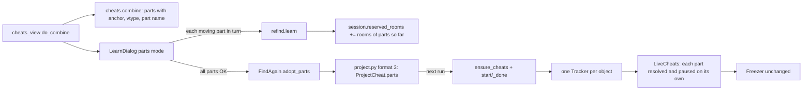

# Architecture: combined cheats that survive restarts

Spec: docs/spec-restart-combined.md. Internal design only (no new dependency, service or cost).

## Choice: an anchor per Location; Cheat.anchor kept for single cheats

- Single found-again cheats keep `Cheat.anchor` and today's code paths unchanged. A combined
  cheat always has `Cheat.anchor = None`; each part's anchor is on its `Location`.
- Replacing `Cheat.anchor` everywhere touches ~25 call sites and every found-again test: higher risk.
- Hazard: a learned part's Location is SESSION_ADDRESS at offset 0. Every write goes through
  `LiveCheats._writes`, `_tracked`, `turn_off`, so the part branch there closes it. A unit test
  asserts no write ever goes to address 0 or to a learned part's `loc.offset`.
- Learned parts stay SESSION_ADDRESS, so `session_only`/`saveable` keep them out of cheat files.



## Data model

### cheats.py
- `Location` new fields (defaults keep existing code working):
  - `anchor: tuple[str, str] | None = None`: a learned part's (object id, field); offset unused.
  - `vtype: ValueType | None = field(default=None, compare=False)`
  - `part: str | None = field(default=None, compare=False)` ("health", "health (2)").
- `Location.moving`: `kind is SESSION_ADDRESS and anchor is None`.
- `Cheat` properties: `combined` (any location has `part`), `learned_parts`, `moving_parts`
  (only when combined), `objects` (ids from `self.anchor` or learned parts), `found_again`
  (`anchor is not None` or (learned parts and no moving parts)).
- `MAX_MOVING = 4`.
- `combine(cheats, name=None, addr_of: Callable[[Location], int | None] | None = None)`:
  - no "found again can't be combined" refusal;
  - part names: cheat name; `name (i)` if it has several locations; already-named parts keep
    theirs; clash gets " (2)";
  - anchored source -> `Location(SESSION_ADDRESS, 0, on, off, anchor=c.anchor, vtype=c.value_type, part=c.name)`;
  - other locations copied with `vtype = loc.vtype or (c.value_type if loc.kind is not CODE_PATCH and c.value_at is None else None)`;
  - more than 4 moving+learned: `ValueError("Combine up to 4 values that move; these have N.")`;
  - overlap by byte range per pair: non-session by (module, offset); session by absolute offset;
    learned through `addr_of`; identical anchors always overlap. `"{a} and {b} overlap in memory."`;
  - result `anchor=None`, `value_type=None`, freeze/hint as today.

### project.py
- `FORMAT_VERSION = 3` (the existing "newer Cheat Maker" error + set_aside covers old apps).
- `ProjectPart`: `name`; learned: `object`, `field`, `value`; fixed: `kind="code_patch"`,
  `module="eboot.bin"`, `section=0`, `offset=0`, `on=b""`, `off=b""`, `vtype=None`.
  Learned recognised by `"object"` key. Offsets via `_hex`, bytes as hex text.
- `ProjectCheat`: `object`/`field`/`value` get defaults; new `parts: list[ProjectPart]`.
  `to_json` writes `{name, action, parts}` when parts, else exactly today's dict. `anchors` property.

```json
{"name": "Health", "action": "freeze", "parts": [
  {"name": "health",   "object": "obj1", "field": "health",   "value": 3.0},
  {"name": "fraction", "object": "obj1", "field": "fraction", "value": 1.0},
  {"name": "god flag", "kind": "module_value", "module": "eboot.bin", "section": 0,
   "offset": "0x1a2b0", "on": "01", "off": "00", "type": "int8"}]}
```

## Per-file changes
- core/refind.py: `class LearnFailed(FindFailed)` with `.notes`; `learn()` raises it; `learn()`
  passes `cancel` to `ah.find_hooks` / `ah.prove_slot`.
- core/anchor_hook.py: only `find_hooks()`/`prove_slot()` get kw `cancel: threading.Event | None`,
  passed via the existing `client.watch(..., until=...)`; `prove_slot` raises ScanCancelled.
  console/*.py untouched.
- core/freezer.py: `Freezer` unchanged. `LiveCheats`: `_part_paused: dict[int, set[str]]`;
  `_part_writes(cheat, on, strict)`: learned parts via `trackers[obj].current()` (cached per
  object per tick), fixed/moving via `loc.address(base)`; strict -> FindFailed
  `"{cheat}: {part} isn't found right now, so nothing was changed. Press Find it again."`;
  non-strict skips lost part, logs `action=freeze key=%s part=%s paused` once / `resumed`;
  returns None if nothing left. `_writes` uses it for combined with learned parts. `turn_on`
  uses `freeze_tracked` for those. `turn_off(restore=True)`: off bytes for fixed/moving parts in
  reverse; learned parts skipped.
- ui/find_again.py FindAgain: `uses(cheat, obj_id)`; `ensure_cheats` rebuilds combined cheats
  from `pc.parts` (skip whole cheat if an object/field is missing; dedupe); `_done` one line per
  combined cheat (`COMBINED_FOUND` / `COMBINED_NOT_FOUND` + open_search), `f.last` for every
  field; `before_on`/`after_off` loop `cheat.objects`; `check_pending` uses `obj_id in c.objects`
  and the part label; `confirm` one `CONFIRM_PARTS` question for all learned parts' trackers;
  `object_id_for` skips parts entries; `new_object_ids(n)`; `forget` drops parts entries;
  `cheat_changed` no-op for combined; `remember_combined(cheat)`; `adopt_parts(cheat, results)`.
- ui/find_again.py LearnDialog: parts mode (`cheat.moving_parts` if combined); single path
  unchanged; `FIND_NEXT_START_PARTS`; no PC-off button; `_on_step` accepts (k, step) and
  prefixes "Part k of n: {part}.".
- ui/cheats_view.py: `keeps_text` FOUND_AGAIN for combined with learned and no moving parts;
  combine button on for >1 picked; learn button for combined (connected, moving parts, all
  vtypes, all learned parts' trackers present); `do_combine` passes `addr_of`, calls
  `remember_combined` when no moving parts.
- ui/save_dialog.py: counts use `c.found_again`.
- ui/hints.py: FIND_NEXT_START_PARTS, FIND_NEXT_PART, READY_PARTS, LEARN_PART_FAILED,
  COMBINED_FOUND, COMBINED_NOT_FOUND, CONFIRM_PARTS, COMBINE_TOO_MANY, OVERLAP.

## Learning several parts (`_start_parts`)
1. Turn the cheat off if on (restore=False). `ids = finder.new_object_ids(n)`, save
   `rooms0 = list(session.reserved_rooms)`, copy `finder.by_chain`, make cancel Event.
2. Worker learns part k=1..n in turn (one watchpoint at a time): check cancel; emit (k,"watch");
   `rf.learn(..., cancel=..., progress=(k-1+f)/n)`; ScanCancelled if cancelled after.
   Same object (same start and same non-None vtable as an earlier part): add field + chains to
   that object; keep its hook (drop this part's planned hook). Then
   `session.reserved_rooms = rooms0 + ah.reserved_rooms(objs_so_far)`.
3. All learned: install per distinct object (chains -> by_chain; else ah.install + note_install
   at once). Track `installed_here`; check cancel between installs.
4. Rollback on any error/cancel: `finder._remove` each in installed_here; restore by_chain;
   reserved_rooms = rooms0; raise `PartFailed(part, k, n, reason)`. Project and cheat untouched.
5. `_done_parts` -> `finder.adopt_parts(...)`; hint READY_PARTS (+ HOOK_NOTE).

## Next run / freezing
- `start()` unchanged. Tick allowed only if confirm passes and strict writes find every part.
- Each freeze tick resolves each learned part; lost part skipped, others written.
- Untick: fixed/moving parts restored; learned left. after_off removes a hook only when no
  enabled cheat uses its object.

## Tests
- unit/test_cheats_templates.py: update the found-again-refused assertion; part names, vtype,
  4 limit, overlap (fixed/fixed, session/session, addr_of), keeps_text/found_again.
- unit/test_project.py: format 3 round trip; format 1/2 load same and save as 3; format 4 "newer".
- unit/test_freezer.py: lost part skipped, other written; paused/resumed logs; turn_on raises
  with part name and writes nothing; turn_off skips learned; never writes to 0 / loc.offset.
- unit/test_anchor_hook.py: cancel stops prove_slot / find_hooks.
- ui/test_find_again.py: combine anchored+session; learn both in one Start (same object -> one
  hook); restart -> one row, one line, one question, both written; move_player pauses/resumes per
  part; part-2 failure rollback; cancel rollback; two objects get different rooms; part not found;
  delete keeps objects.
- ui/test_ui_flow.py: Combine on with an anchored cheat.

## Risks
- Address 0 writes (covered by test). Same-object merge relies on vtable. Cancel timing depends
  on watch()'s `until=` (sibling thread edits watch(); must keep it). Two parts hooking the same
  instruction: second install fails -> note, fallbacks remain. Combine drops source notes entries.
  `_part_paused` touched from freezer thread.

## Order
1 cheats.py; 2 project.py; 3 freezer.py; 4 hints/cheats_view/save_dialog; 5 FindAgain;
6 refind LearnFailed + cancel plumbing; 7 LearnDialog parts mode + UI tests; 8 user guide 6/6.4/7.2
and console test C19.
