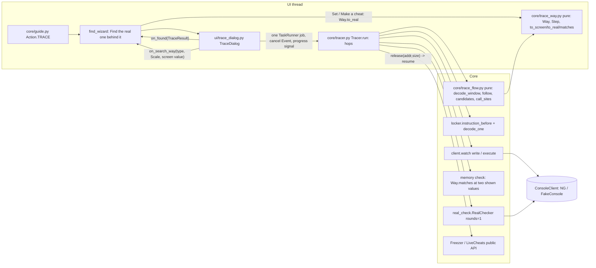

# Find the real one behind it: design

Date: 2026-11-11. Spec: docs/spec-trace.md. [OPEN] items use their defaults. Style follows docs/architecture-cheat-builder.md.
No new runtime dependency: iced-x86 (already in `pyproject.toml`) does all decoding, and its `BlockEncoder` assembles the test fixtures. unicorn stays an optional `importorskip` used only in QA tests.

## Goal & assumptions

Start from a Find row that is a screen copy (a HUD or widget number). Catch who writes it with a write watch. Follow the game's code backwards from that write to the load it copied from, and record how the number was changed on the way (the **way**). Work out the load's address, check that it holds the matching number, and test it with Check which is real's write test. Repeat up to 4 hops.

Assumptions:
- Scale: one player, one game, one trace at a time. Each trace lasts up to 4 minutes and makes a few dozen console requests.
- It runs on the desktop app's worker thread (PySide6 `TaskRunner`) against PS5Debug-NG 1.3.x. There is no server and no running cost.
- C10a (registers in a watch hit) is not verified yet. Every address worked out from registers is therefore proven by the memory check (AC-T5) before anything is written, so wrong registers give "no row", never a wrong row.
- XMM registers are not read from the packet. Constants must come from the code itself: immediates, or RIP-relative data.

Files this design does **not** touch (sibling branch): `core/cheats.py`, `core/freezer.py` (public API only: `unfreeze`/`freeze`, `LiveCheats.turn_off/turn_on`), `core/project.py`, `core/refind.py`, `ui/find_again.py`, `ui/cheats_view.py`. Traced rows need no new `Cheat` fields: Set and Make a cheat convert the typed number to raw bytes before the cheat is made.

## Overview



States per hop: Watching -> ReadingCode -> Checking (first value, wait for change, second value) -> [ExecBreakpoint, only when the setting is on and nothing passed] -> WriteTest. The write test leads to:
- Found (real or kept);
- NextHop (copy, while hops < 4, the address is new and the way is carried on);
- End (an AC-T8 reason).

How it fits together:
- The dialog runs the whole trace as **one** background job (`Tracer.run(progress, cancel)`). Unlike Make it work, a trace never asks the player a question; the player only plays. Each step is still a public method, so tests drive the steps one by one.
- `trace_flow` is pure. It takes decoded iced-x86 instructions, the trap registers and an injected `read(addr, n)`, and returns paths and candidate addresses. It never talks to a console, so every pattern is unit-tested from assembled bytes.
- `trace_way` is plain number maths with no x86. The UI imports it to show `0.87 (screen: 87)` and to convert typed screen numbers.
- The tracer's only writes go through `RealChecker`, which already puts back on every path. Pausing a freeze is undone in `finally`. Cancel ends a watch within about 0.5 s (NG `until` tick) plus the detach, and a write-test round within its 1 s settle, so Cancel finishes within 2 s.
- Only one debugger job runs at a time:
  - The dialog is modal, so Lock it, Make it work and Find it next time can't start while a trace runs.
  - The Find button is disabled while `ctl.tasks.busy`. Find it next time collects through `ctl.tasks.run`, so this covers the reverse direction with no edit to `find_again.py`.

## Component choices

| Concern | Choice | Licence / Cost | Why | Alternatives considered |
|---|---|---|---|---|
| Decode game code | iced-x86 >= 1.21 (already a dependency), `InstructionInfoFactory` for register reads and writes | MIT, free | Already used by locker, cave and builder. Gives per-operand access, `rflags`, `ip_rel_memory_address` and `flow_control` | capstone (BSD): a second disassembler for no gain |
| Assemble test fixtures | `iced_x86.BlockEncoder` + `Instruction.create_*`, wrapped in `tests/asm.py` | MIT, free | `cave._encode` already uses it. It resolves branch and call targets and is the same library that decodes, so fixtures can't drift | Hex blobs (as in `test_locker.py`): unreadable for 6-10 instruction paths, kept only for single instructions. minicpu is an interpreter, not an assembler. keystone is GPLv2 and a new dependency |
| Run fixtures to get real trap registers | `tests/minicpu.py`, extended with a closed set (see Tests) | own code | Registers then really are what the code leaves, so "base overwritten, use replay" cases are honest. Copies are re-written every read, as a game does, which is what RealChecker needs to see | Hand-written `WatchHit.regs` only: easy to make inconsistent with the code. Still used for `rep movsb` and stack-only cases |
| Write test | `core/real_check.RealChecker` plus a new `run(..., rounds: int \| None = None)` | own code | Reuses put-back rules AC-R4, follower factor maths and `not_restored` | A tracer-specific writer: duplicates risky put-back code |
| Watch / execute breakpoint | `ConsoleClient.watch(kind="write" \| "execute")` | own code | Same attach / continue / detach path as Lock it. `execute` = DR7 RW=00, len 1 | Software int3 breakpoints: out of scope, they patch code |
| Settings | `settings.py`: `trace_exec_breakpoint: bool = False`, `trace_notice_hidden: bool = False` | own code | Spec defaults | — |

## Paid items

None. Everything is free and open source, and no hosted services are used.

## Estimated running cost

$0 a month at any scale. It is a local desktop feature, and console time per trace is at most 4 minutes.

## Structure

### New modules

| File | Responsibility | Depends on |
|---|---|---|
| `src/cheatmaker/core/trace_way.py` | `Step`, `Way`: forward maths matching what the game's CPU does (float32 rounding per step), inverse for Set, AC-T5 match rules, labels, `as_scale()`, composing hops | `core/values.py` only |
| `src/cheatmaker/core/trace_flow.py` | Pure analyser: `decode_window`, `writer_at` (incl. `rep movs` at rip), `follow` (backward data flow), `candidates` (regs, replay, block copy), `call_sites` + `follow_into_caller` (one caller up), `exec_address` | iced-x86, `locker.instruction_before/decode_one`, `trace_way` |
| `src/cheatmaker/core/tracer.py` | `Tracer` driver: alignment, watch, writers from hits, memory check, exec-breakpoint fallback, write test, hops, circle, deadlines, logs; `TraceResult`, `Hop` | client, session, locker, trace_flow, trace_way, real_check |
| `src/cheatmaker/ui/trace_dialog.py` | `TraceDialog`: notice, Start, progress with step label, Cancel, Advanced list, result text, **Search for it that way** | tracer, hints |
| `tests/asm.py` | `asm(ip, *insns) -> bytes` over BlockEncoder; small builders `mov(dst, src)`, `movss`, `mem(base, disp, index, scale)`, `rip(target)`, `call(target)` | iced-x86 |
| `tests/tracegame.py` | Fake game for traces: module code, read-only data (constants), writable data (globals), heap objects, stack. Places snippets, runs them on minicpu every read (copies refresh like a game), records `WatchHit`s with registers | fake, minicpu, asm |

### Changed modules (small, all backward compatible)

- **`console/client.py`**
  - `WatchKind = Literal["write", "access", "execute"]`. `execute` means `addr` is an instruction, `size` must be 1, and hits carry the registers *before* the instruction.
  - `WatchHit.raw: bytes = field(default=b"", compare=False, repr=False)`: the 0x4A0 packet, for the AC-T11 debug log.
- **`console/ps5debug_ng.py`**
  - `_DR7_KIND["execute"] = 0` (PROTOCOL.md §7.3 breaktype 0); `size != 1` with execute raises `ValueError`.
  - `parse_interrupt` keeps `raw=packet`.
- **`console/fake.py`**
  - `exec_hits: dict[int, list[WatchHit]]`, served for `kind == "execute"`; `"execute"` accepted.
- **`core/real_check.py`**
  - `run(progress=None, cancel=None, rounds=None)`: stop after `rounds` rounds. The tracer uses `rounds=1`, so only the source is written and the rest of the group are followers.
- **`core/guide.py`**
  - `Action.TRACE`.
  - `Guide.after_check(verdicts) -> Suggestion | None`: every checked row is COPY.
  - `Guide.after_put_back() -> Suggestion`.
  - Text: `TRACE_HINT = "These look like copies the screen uses. Press Find the real one behind it."`
- **`settings.py`**: the two booleans above, validated like `build_notice_hidden`.
- **`ui/controller.py`**: `trace_notice_shown = False` (once per run).
- **`ui/hints.py`**: every trace string. The plain texts come from the spec verbatim.
- **`ui/find_wizard.py`**: button, traced rows, Set and Make conversion, Search for it that way, guide wiring (see Screen units).

### Data types

`core/trace_way.py`

```python
class Kind(Enum):
    EXTEND = "extend"          # movzx/movsx/movsxd, 32-bit mov zero-extends; signed: bool
    TO_DECIMAL = "to decimal"  # cvtsi2ss / cvtsi2sd
    TO_WHOLE = "to whole"      # cvttss2si/cvttsd2si (cut) | cvtss2si/cvtsd2si (round)
    WIDEN = "widen"            # cvtss2sd
    NARROW = "narrow"          # cvtsd2ss
    MUL = "mul"                # by const (mulss/mulsd/imul imm/RIP-relative)
    DIV = "div"                # by const
    SHARE = "share of max"     # divided by a loaded max; max read now

@dataclass(frozen=True)
class Step:
    kind: Kind
    to: ValueType                      # number type after this step
    const: float | None = None         # MUL/DIV
    rounding: Literal["cut", "round"] | None = None   # TO_WHOLE
    signed: bool = True                # EXTEND
    max_at: int | None = None          # SHARE: the max's address

@dataclass(frozen=True)
class Way:
    """How the real value becomes the shown one: screen = steps(real)."""
    real: ValueType                    # how the source keeps it
    shown: ValueType                   # the watched copy's type
    steps: tuple[Step, ...] = ()       # in the game's order, real -> shown

    def then(self, outer: "Way") -> "Way"          # compose: source->copy1 then copy1->screen
    def factor(self, max_now: float | None = None) -> float   # screen = real x factor
    def to_screen(self, real, max_now=None) -> float | int    # float32-faithful forward
    def to_real(self, screen, max_now=None) -> float | int    # inverse, nudged (see below)
    def matches(self, real, shown, max_now=None, unit: float = 1.0) -> bool  # AC-T5 rules
    def label(self) -> str             # "as shown", "x0.01 of the screen", "share of max"
    def as_scale(self, max_now=None) -> Scale  # Scale(f"traced x{1/f:g}", 1/f, decimal=real.is_float)
    @property
    def rounding(self) -> Literal["exact", "cut", "round", "decimal"]: ...
```

`matches` rules (AC-T5):
- whole numbers (no conversion): exact;
- `cut`: `floor(x) == shown` (toward zero for negatives, as `cvtt*` does);
- `round`: `|x - shown| <= 0.5`;
- decimals: `|x - shown| <= max(0.01 * |shown|, unit)`.

`to_real` inverts the factor, then steps by float32 ULPs (at most 8) until `to_screen(r) == screen`. Without this, a typed 87 becomes 0.87f, and `cvttss2si(0.87f * 100)` gives 86.

`core/trace_flow.py`

```python
@dataclass(frozen=True)
class MemRef:            # a memory operand, by register name
    base: str | None; index: str | None; scale: int; disp: int
    rip_target: int | None; size: int
    def text(self) -> str            # "[rbx+30h]"

@dataclass(frozen=True)
class Load:
    ip: int; text: str; mem: MemRef
    lane: int            # byte offset inside the loaded bytes (vector lanes)
    at: int              # index in Window.insns

class End(Enum):
    SOURCE = "source"; BLOCK_COPY = "block copy"; CONSTANT = "fixed number"
    CALL_RESULT = "result of a call"; BLOCK_START = "start of the code block"
    BRANCH = "a branch inside the path"; NOT_FOLLOWED = "a step it doesn't follow"
    SCRAMBLED = "scrambled"; ALREADY_REAL = "read-modify-write"

@dataclass(frozen=True)
class Window:
    insns: tuple[ix.Instruction, ...]   # straight line, last one is the writer
    @property
    def writer(self) -> ix.Instruction

@dataclass(frozen=True)
class Path:
    end: End
    way: Way | None              # steps followed so far (SOURCE, BLOCK_COPY, BLOCK_START)
    load: Load | None = None     # SOURCE
    max_load: Load | None = None # SHARE
    reg: str | None = None       # BLOCK_START: the register the value arrives in
    followed: tuple[str, ...] = ()   # instruction texts, writer first (Advanced)
    reason: str = ""             # e.g. "add eax,ecx at 0x40123a"

@dataclass(frozen=True)
class Candidate:
    address: int
    method: Literal["regs", "replay", "block", "caller", "exec"]
    expr: str                    # "[rbx+10h]", "[[rbx+30h]+8]+10h", "watched+(rsi-rdi)"
    max_address: int | None = None
    writer: int = 0

Read = Callable[[int, int], bytes]          # same as locker.Read
IsConst = Callable[[int], bool]              # address is in a non-writable map

def decode_window(code: bytes, writer_ip: int, writer_len: int) -> Window
def writer_at(code_before: bytes, code_at: bytes, rip: int) -> tuple[int, bytes, str] | None
def follow(win: Window, lane: int, read: Read, is_const: IsConst) -> Path
def candidates(win: Window, path: Path, hit: WatchHit, watched: int, read: Read) -> list[Candidate]
def call_sites(stack: bytes, rsp: int, code_range: tuple[int, int], read: Read) -> list[int]
def follow_into_caller(read: Read, call_ip: int, reg: str, hit: WatchHit, is_const: IsConst) -> tuple[Path, list[Candidate]]
def exec_address(load: Load, hit: WatchHit) -> int
```

`core/tracer.py`

```python
@dataclass
class WriterPath:
    writer: Writer               # locker.Writer (address, code, text, hits)
    path: Path | None
    skipped: str | None = None   # "sets it to a fixed number", "scrambled", ...

@dataclass
class Hop:
    n: int                       # 1..4
    watched: rc.Target           # address + type watched in this hop
    span: tuple[int, int]        # (address, size) actually watched (alignment)
    hits: int = 0
    writers: list[WriterPath] = field(default_factory=list)
    tried: list[tuple[Candidate, str]] = field(default_factory=list)  # "held 12, expected 87"
    source: Candidate | None = None
    way: Way | None = None       # this hop: source -> watched
    verdict: rc.Verdict | None = None
    stop: str = ""

class Outcome(Enum):
    FOUND = "found"; ALREADY_REAL = "already real"; NO_WRITER = "no writer"
    CANT_WATCH = "can't watch"; SEARCH_THAT_WAY = "search that way"
    NOT_FOLLOWED = "not followed"; SCRAMBLED = "scrambled"; TOO_FAR = "too far"
    UNCONFIRMED = "number didn't change"; CANCELLED = "cancelled"; LOST = "lost"

@dataclass(frozen=True)
class TraceResult:
    outcome: Outcome
    behind: int                  # the start row's address
    address: int | None = None   # found (or "not sure") source
    vtype: ValueType | None = None
    way: Way | None = None       # total: real -> start row's screen value
    verdict: rc.Verdict | None = None   # REAL / KEPT; None = not sure
    hops: tuple[Hop, ...] = ()
    not_restored: tuple[int, ...] = ()
    message: str = ""            # the plain hint (AC-T7 / AC-T8)

class Tracer:
    def __init__(self, session, address, vtype, *,
                 release: Callable[[int, int], Callable[[], None]] | None = None,
                 exec_breakpoint: bool = False,
                 sleep=time.sleep, clock=time.monotonic) -> None
    def run(self, progress: Callable[[float, str, str], None] | None = None,
            cancel: threading.Event | None = None) -> TraceResult
    # steps (public for tests): watch(hop, cancel) -> list[WatchHit]
    #   read_code(hop, hits) -> list[Candidate]; check(hop, cands, cancel) -> Candidate | None
    #   exec_fallback(hop, cancel) -> Candidate | None; test(hop, cand, cancel) -> rc.Verdict
```

Constants: `WATCH_S=30`, `EARLY_HITS=3`, `EARLY_MORE_S=2`, `MAX_WRITERS=3`, `MAX_HOPS=4`, `WINDOW=256`, `STACK_SEARCH=512`, `STEADY_S=1`, `CHANGE_WAIT_S=30`, `POLL_S=0.25`, `EXEC_HITS=16`, `EXEC_S=10`, `TOTAL_S=240`, `HOP_WORK_S=15`. Going over `HOP_WORK_S` is logged; going over `TOTAL_S` ends the trace as TOO_FAR with the last checked source.

### The analyser (`trace_flow.follow`), rule by rule

**Window.** `decode_window` takes the 256 bytes before the writer. It decodes straight through from every start offset, the same way `locker._chain_end` does. It keeps the chains that land exactly on the writer and uses their **common suffix**, which is the part where x86 decoding has re-synchronised. The earliest instructions of a mis-synced start are dropped. Stop markers are found inside the window as follows. Walking backwards, the window is cut at the last `ret`, `int3`, unconditional `jmp`, indirect jump or invalid byte before the writer. Everything after that marker is the code block (AC-T3).

**Writer (`writer_at`).**
- Normally this is `locker.instruction_before(code_before, rip)`.
- For `rep movs` / `rep stos`, a data trap mid-copy can leave RIP **at** the instruction. So the instruction decoded at `rip` is also tried when it has a rep prefix and writes memory. This is unverified on the console and logged.
- A writer that is read-modify-write on the watched address (`sub [rax+2B0h],ecx`, `add`, `xadd`) gives `End.ALREADY_REAL` at once.
- `mov [m], imm` gives `CONSTANT`, so the writer is skipped as "sets it to a fixed number".

**Tracked location.** The tracked value starts at the writer's source register, at byte `lane = watched - store_address`. The store address comes from the writer's operand and the trap registers; a store doesn't change its own base. Walking backwards over `insns[block_start : writer]`, each instruction that **writes the tracked register** is handled like this:

| Instruction (examples) | Action |
|---|---|
| `mov r,r` / `movss|movsd|movaps|movups|movdqa|movdqu x,x` / `movd|movq x<->r` / VEX forms | tracked = source register (lane kept; `movd`/`movq` need lane < 4 or 8) |
| `movzx`/`movsx`/`movsxd`, 32-bit `mov r32,r32` | add `EXTEND`; tracked = source |
| `cvtsi2ss/sd x, r|m` | add `TO_DECIMAL`; memory operand gives SOURCE |
| `cvttss2si/cvttsd2si` | add `TO_WHOLE(cut)`; `cvtss2si/cvtsd2si` add `TO_WHOLE(round)` (MXCSR assumed nearest) |
| `cvtss2sd` / `cvtsd2ss` | add `WIDEN` / `NARROW` |
| `mulss/mulsd x, m|x`, `imul r, r|m, imm` | constant factor: an immediate; a RIP-relative load where `is_const(target)`; or the other register traced back (sub-search, same window) to an immediate (`mov eax,imm ; movd xmm1,eax`) or a constant load. Add `MUL`. Two loaded values multiplied gives NOT_FOLLOWED |
| `divss/divsd x, m|x` | divisor constant: add `DIV`. Divisor a non-constant load: it is a **max**, so add `SHARE(max_load)` and keep following the numerator |
| `mov r,[m]` / `movss x,[m]` / `movzx r,[m]` / `vmovups y,[m]` | SOURCE: `Load(mem, lane)`. Type comes from the load size, register class and the first step after it (FLOAT/DOUBLE for xmm scalar, INTn for GPR; a whole vector load takes the copy's element type) |
| `mov r, imm`, `xor r,r` (same register) | CONSTANT |
| `xor/rol/ror/not/bswap` on tracked | SCRAMBLED |
| `add/sub/inc/dec/neg/lea/shl/...` on tracked, `pop` | NOT_FOLLOWED (`reason` names the instruction) |
| `call` | tracked in `rax/eax/xmm0`: CALL_RESULT. Tracked in a caller-saved register: NOT_FOLLOWED ("a call changes it"). Callee-saved (`rbx, rbp, r12-r15`): keep walking |
| `jcc` while walking | BRANCH (spec: branches inside the path stop) |
| block start reached | BLOCK_START with `reg` = tracked |

Instructions that don't write the tracked register are skipped. Their register writes matter only for address resolution, below.

**Address resolution (`candidates`, AC-T4).** It runs for every hit of that writer: up to 16, each with its own registers, deduplicated by address. A shared copy routine therefore still yields the right object, because the watchpoint only fires for our address.

1. **regs.** Each base and index register of `load.mem` must not be written in `insns[load.at : writer]`. That range includes the load itself (`mov rax,[rax+8]` overwrites its own base) and the writer, and a call clobbers caller-saved registers. If they survive, the address is `hit.regs[base] + hit.regs[index]*scale + disp`. A RIP-relative load is `mem.rip_target` (fixed).
2. **replay.** For a base overwritten before the load, find its last definition before `load.at`:
   - an 8-byte `mov r,[m2]` resolves `m2` by rule 1 or rule 2 (depth at most 3) and reads 8 bytes from the game **now**;
   - `mov r,r2` and `lea r,[r2+d]` are followed.
   
   The expression is recorded as `[[rbx+30h]+8]+10h`.
3. **block.** `rep movsb/movsd/movsq` gives `watched + (rsi - rdi)`. With DF=0 the difference is the same at every iteration.
4. **caller** (only for BLOCK_START with an argument register `rdi rsi rdx rcx r8 r9 xmm0-7`):
   - `call_sites` reads 512 bytes at `hit.rsp` and keeps each qword inside the game module whose preceding bytes decode to a `call` ending exactly there (`instruction_before(..., want=is_call)`).
   - `follow_into_caller` runs `decode_window` + `follow` from the call site for that register, then rule 1 using **only** `rbx, rbp, r12-r15` from the trap. The callee must not write those registers inside its own window, otherwise the candidate is dropped. Rule 2 also applies.
   - One level only.
5. **exec** (setting on, nothing passed AC-T5): `watch(pid, load.ip, 1, "execute", EXEC_S, until=16 hits or cancel)`. The registers are before the load, so `exec_address(load, hit)` is exact. Hits whose address fails AC-T5 are dropped. 16 hits with identical registers at the same RIP means "the breakpoint repeats": log it and stop.

`is_const(addr)` is "inside a mapped region that is not writable" (from `client.maps`, cached once per trace). It separates a RIP-relative `100.0` from a writable global max.

### The driver (`Tracer.run`), one hop

1. **Alignment** (pure `watch_span(addr, vtype)`):
   - 8-byte values: 8-aligned is watched as 8; 4-aligned as `(addr, 4)`; otherwise the 4-byte rule applies.
   - 4-byte values: 4-aligned as 4; 2-aligned as `(addr, 2)`; an odd address gives CANT_WATCH.
   - 2-byte values: 2-aligned or CANT_WATCH. 1-byte values: 1.
2. **Release:** `resume = release(addr, size)` (the dialog pauses the matching freezes) is collected and run in `finally`.
3. **Watch:** `client.watch(pid, *span, "write", WATCH_S, until=…)` ends on Cancel, or 2 s after 3 hits. No hits gives NO_WRITER. The first hit's `raw` is logged at debug.
4. **Writers:** hits are grouped by RIP, most hits first, and up to 3 distinct writers are kept. For each, 256 + 16 bytes around the RIP are read, then `writer_at`, `decode_window` and `follow` run. Constant writers are skipped. ALREADY_REAL ends the hop: at hop 1 it gives "This is already the value the game uses." and no row; at a later hop the watched address is the result.
5. **Candidates:** regs, replay and block for every writer, then caller. They are batched so **one** player change checks them all (see the next step).
6. **Memory check (AC-T5):**
   - Poll the copy every 0.25 s until it has held one value for 1 s. Read every candidate (and its max) and drop those where `way.matches(...)` fails (Advanced: "held 12, expected 87").
   - Then wait up to 30 s, with the hint asking the player to change the number, for a different steady value, and check again.
   - No change gives UNCONFIRMED ("Change the number in the game so the app can check.").
   - The first survivor in method order wins. If none survives, the exec fallback runs (step 6a) if the setting is on.
   - If there is still no address but some path gave a way, the result is SEARCH_THAT_WAY. Otherwise the result is the path's end reason (NOT_FOLLOWED, SCRAMBLED, NO_WRITER).
7. **Write test:** `RealChecker(client, pid, [[Target(source, way.real), Target(copy, copy type), *earlier hops]]).run(cancel=cancel, rounds=1)`.
   - REAL or KEPT gives FOUND with the total way (`hop.way.then(previous total)`).
   - COPY means: if the source has been seen before, TOO_FAR ("goes round in a circle"); if this was hop 4, TOO_FAR with the source as "not sure"; otherwise the next hop watches the source with type `way.real`.
   - FAILED gives NOT_FOLLOWED-style "couldn't be checked" (AC-T8).
   - `checker.not_restored` is copied into the result.
8. **Errors:** `ConnectionLost` is caught in `run`. It gives LOST, keeps `not_restored`, and the resume callbacks still run with errors swallowed and logged.

**Logs (AC-T11):**
- `action=trace_start addr= type= hops_max=4 exec_bp=`
- `trace_watch hop= addr= size= hits=`
- `trace_writer writer= text= hits= skipped=`
- `trace_path end= followed="a|b|c" way= reason=`
- `trace_source method=regs|replay|block|caller|exec addr= expr=`
- `trace_check addr= held= expected= ok=`
- `trace_test addr= verdict= followers=`
- `trace_hop n= stop=`
- `trace_result outcome= addr= way= hops= secs=`
- `trace_restore not_restored=`
- the raw packet in hex at debug level.

### Screen-unit conversion for traced rows (minimal changes, all in `ui/find_wizard.py`)

- **State.** A traced row is added like Test the hits' winner: `self.manual[addr] = vt`. A sidecar `self.traced: dict[int, TracedRow]` is added, with `TracedRow = (way: Way, behind: int, check: str, sure: bool)`. Everything that already handles manual rows (refresh, remove, new game, Lock it, Make it work) keeps working. `do_remove_address` and `_new_game` also drop the entry from `traced`.
- **Value now** (`_row_text`): for traced rows, `f"{fmt_value(m.value)} (screen: {fmt_value(way.to_screen(m.value, max_now))})"`.
- **Stored as** (`_item_text` column 1): `way.label()` for traced rows, even without `has_ways`.
- **Notes** (column 2): `"found behind 0x…, checked: real"` (or `"not sure"`).
- **Plain table** (2 columns): the same three facts are appended to Value now, as `(added, …)` is today.
- **Set** (`do_set`): `value = parse_number(text)`; if the row is traced, `value = way.to_real(value, max_now)`, then `row_type.encode(value)` as today.
- **Make a cheat** (`do_make`): the same conversion before `make_cheat(..., value)`. The cheat stores raw bytes, so `core/cheats.py` is unchanged.
- **Unchanged:** Freeze, Make it work and Lock it keep using address and type as today. Percent and fraction rows keep raw units.
- `max_now` (share-of-max ways) is read once per refresh from `way.max_at` (one extra read per traced row).
- **Search for it that way:** `search_traced_way(vtype, scale, screen)`:
  - runs `do_reset()` and checks Advanced;
  - sets the type combo, adds or replaces a combo item `"traced x0.01"` with data `"traced"`, and has `_scale()` return `self._traced_scale` for that data (`Scanner.first_scan` already accepts any `Scale`, and its unit window scales with `factor`);
  - fills `number`, then calls `_suggest(Suggestion(..., Action.SEARCH))`. The player presses Search.

### UI (`ui/trace_dialog.py`, `ui/find_wizard.py`)

**Button.**
- A `QPushButton(hints.TRACE_BUTTON)` is placed in the **Advanced** box with the label "Find the real one behind it (being tested)" while `hints.TRACE_TESTED = False`. When C20a passes, flip the constant and the button moves to the action row.
- It is enabled when one row is selected, the address is not 0, the type size is in {1, 2, 4, 8}, and `not ctl.tasks.busy` (re-evaluated on `tasks.busy_changed`). Otherwise the tooltip is "Pick one row in the list."
- A group row traces its head, an expanded member traces that member (`_tree_selection`). `_action_widget` maps `Action.TRACE` to this button.

**Dialog.**
- The once-per-run notice "Save your game first. This writes test values and briefly pauses the game." uses `ctl.trace_notice_shown` and `settings.trace_notice_hidden` ("Don't show this again"), following `MakeItWorkDialog._maybe_notice`.
- Controls: hint label, step label ("Watching (1 of up to 4)", "Reading the game's code", "Checking"), progress bar, Start, Cancel, Advanced (show details) list with the AC-T10 lines per hop, and a hidden **Search for it that way** button.
- `release(addr, size)`:
  - unfreezes `find:{a}` keys overlapping the range (freeze bytes read just before unfreezing);
  - turns off enabled cheats whose location overlaps, with `LiveCheats.turn_off(restore=False)`;
  - returns a resume that re-freezes and turns back on.
  
  `Freezer` is thread-safe; `cheats_changed` is emitted through a queued signal.
- Cancel sets the job's Event. Closing while running sets it and waits for the job's done callback before `accept`/`reject`, as build_dialog does with `_rejected`. A Disconnect hook goes in `ctl.before_disconnect`.
- The result calls `on_found(result)`. FindWizard adds the row, selects it, and shows the AC-T7 hint ("Found the value the game uses: 0.87, a decimal; the screen shows it x100.").

**Guide.**
- After `_after_check`, if `guide.after_check(...)` returns TRACE, `_suggest` it.
- After Set, a `QTimer.singleShot(2000)` re-reads the row. If the value differs from what was written, `_suggest(guide.after_put_back())`.
- After Freeze, the same check compares against the frozen bytes. This is best-effort: the freezer may win the race; noted under risks.

## Tests

### Fixture strategy

- **Assemble with iced-x86's BlockEncoder** (`tests/asm.py`), not minicpu and not hand-hex. cave.py already does this.
  - Each fixture lists instructions built with `Instruction.create_*` at a fixed module address.
  - Every fixture test first asserts the decoded Intel text of the bytes (`"movss xmm0,dword ptr [rbx+10h]"`). This catches a wrong `Code` choice.
  - RIP-relative constants use a `MemoryOperand(Register.RIP, displ=target)`, which BlockEncoder should turn into the right relative displacement. **Check this in slice 3.** If it doesn't, the helper encodes twice and patches the disp32 from `ip_rel_memory_address`.
- **Pure analyser tests** (no FakeConsole): `decode_window(asm(...))`, then `follow(...)`, then `candidates(win, path, WatchHit(rip, regs), watched, read)`. `read` and `is_const` come from a dict of regions. Registers are hand-written here, which is easy to read for single-hop rules.
- **Driver tests** use `tests/tracegame.py` on FakeConsole:
  - the module code region (R|X) holds the snippets; read-only data (R) holds constants like `100.0`; writable data holds globals and maxes; the heap holds objects; there is a stack;
  - a game tick (`fake.game_ticks`) runs every snippet on minicpu before each read, so copies are re-written every "frame" as a game does. RealChecker sees copies put back, and sees copies follow the real value;
  - the tick that runs a writer records `WatchHit(rip=writer_end, regs=cpu registers)` into `fake.write_hits[copy]`, so the registers really are what the code leaves (including `rax` reused, which forces replay);
  - `TraceGame.play(change)` changes the real value after N reads, which drives the "two different shown values" check;
  - `sleep` and `clock` are injected, so tests don't wait.
- **minicpu extension** (closed set, with the same "unknown mnemonic raises" rule):
  - `MOVZX`, `MOVSX`, `MOVSXD`, `IMUL` (3-operand immediate);
  - `CVTTSS2SI`, `CVTSS2SI`, `CVTSI2SS`, `CVTSS2SD`, `CVTSD2SS`, `CVTTSD2SI`;
  - `DIVSS`, `MULSD`, `DIVSD`, `MOVSD` (SSE form), `MOVQ`, `MOVAPS`, `VMOVUPS`/`MOVDQU` (128-bit), `UNPCKLPS` (lane fixture);
  - direct `CALL`, `RET`.
  
  `rep movsb` stays unsupported: that one fixture uses hand-written `rsi/rdi/rcx` and pokes the copy itself. `tests/qa/test_minicpu_vs_unicorn.py` gains the new instructions (optional unicorn mirror).

### AC-T12 matrix

All run as core tests with no Qt. Each asserts address, way, outcome, and that `fake.writes` leaves no test value.

| Pattern | Fixture (writer last) | Expect |
|---|---|---|
| float copy | `movss xmm0,[rbx+10h]; movss [rdi+40h],xmm0` | regs, `[rbx+10h]`, way as shown FLOAT |
| int copy | `mov eax,[rcx+8]; mov [rdx],eax` | regs, INT32 as shown |
| cut | `movss xmm0,[rbx+10h]; cvttss2si eax,xmm0; mov [rdi],eax` | FLOAT, TO_WHOLE(cut); 87.9 -> 87 passes |
| x100 RIP-relative | `movss xmm0,[rbx+10h]; mulss xmm0,[rip+K100]; cvttss2si eax,xmm0; mov [rdi],eax` | factor 100, label "x0.01 of the screen", Set 87 writes a float whose cut x100 is 87 |
| share of max | `movss xmm0,[rbx+10h]; divss xmm0,[rbx+14h]; mulss xmm0,[rip+K100]; cvttss2si eax,xmm0; mov [rdi],eax` | SHARE + MUL, `max_at = rbx+14h` |
| replay | `mov rax,[rbx+30h]; mov rax,[rax+8]; mov ecx,[rax+10h]; xor eax,eax; mov [rdx],ecx` | replay `[[rbx+30h]+8]+10h` |
| global | `mov eax,[rip+G]; mov [rdi],eax` | regs (fixed) G |
| block copy | `rep movsb` (hand regs) | `watched + (rsi-rdi)` |
| vector lane | `vmovups xmm0,[rsi]; vmovups [rdi],xmm0`, watch `rdi+8` | `[rsi]+8` |
| caller | caller: `lea rbx,[obj]; movss xmm1,[rbx+20h]; call setter`; setter: `movss [rdi+40h],xmm1; ret` | BLOCK_START xmm1, then caller: stack return address, `[rbx+20h]` |
| already real | `sub [rax+2B0h],ecx` (fakegame form) | ALREADY_REAL, no row, "This is already the value the game uses." |
| scrambled | `mov eax,[rbx+10h]; xor eax,[rip+KEY]; mov [rdi],eax` | SCRAMBLED, no write |
| wrong path | path resolves to an address holding another number | dropped "held 12, expected 87", no row |
| 2 hops | HUD <- widget <- real (two snippets per tick) | FOUND at real, way composed, group at hop 2 = [real, widget, HUD] |
| circle | hop 2's source = hop 1's copy | TOO_FAR, last checked source offered "not sure" |
| no writer / can't watch / cancel / lost | empty `write_hits`; odd 4-byte address; cancel set in `until`; `fake.disconnect()` mid-test | messages per AC-T8 / AC-T9; resume callbacks ran; `not_restored` named |
| exec fallback | setting on, `fake.exec_hits[load_ip]` with differing hits; and 16 identical | method=exec; "the breakpoint repeats" logged, stop |

Also tested:
- `trace_way` (inverse round-trips for every type and rounding, matches rules, compose, labels, `as_scale`);
- `watch_span`;
- `real_check rounds=1`;
- the guide's new suggestions;
- client contract for `execute`;
- a UI flow test with a synchronous TaskRunner (button state, notice once, traced row texts, Set converts 87 to 0.87 bytes, Search for it that way fills Advanced).

## Trade-offs & risks

1. **Registers unverified (C10a).** Wrong registers only give "no row", because AC-T5 is required before any write. C20a decides whether the button leaves Advanced.
2. **Straight-line view.** A merge point inside the 256 bytes (a jump target we can't see) can make the path wrong. The memory check catches this. Branches seen on the path stop it; that is deliberate.
3. **Caller rule.** The callee may save and reuse `rbx`/`r12`-`r15` outside the decoded window. The candidate is dropped only when that happens inside the window; otherwise AC-T5 filters it.
4. **`rep movs` RIP position** on a mid-copy data trap is unverified. Both readings are handled, and the actual one is logged.
5. **Execute breakpoint.** NG may not set RF on continue, so the breakpoint re-fires forever. It is detected after 16 identical hits and off by default (C20d).
6. **MXCSR** is assumed round-to-nearest for `cvtss2si`. A game using another mode is caught by the round rule's ±0.5 tolerance, or fails AC-T5.
7. **Float32 inverse for Set** may need several ULP steps. It is capped at 8, after which the row says it can't be set exactly and the nearest is written.
8. **Detecting a Freeze put back** races with the freezer's own writes. The guide hint may not appear for Freeze; Set detection is reliable.
9. **INT8/INT16 from `movzx`** are unsigned, but ValueType is signed. A real value above 127 or 32767 shows negative; noted in the log, not fixed in this version.
10. **Time.** A hop is 30 s watch + up to 30 s change + about 3 s of checks. 4 hops exceed 4 min only when the player is slow; `TOTAL_S` ends it with "not sure".
11. **One extra read per traced row per refresh** for share-of-max ways. That is negligible.

Revisit the design when:
- C20a fails: drop "regs" and rely on replay and exec;
- XMM registers become readable from the packet: constants and caller cases simplify;
- the out-of-scope items (offsets, sums, scrambles) are wanted.

## Implementation steps (each a commit)

1. **Client: `execute` watch + raw packet.** `WatchKind`, NG `_DR7_KIND["execute"]=0` with the size-1 check, `parse_interrupt(raw=)`, FakeConsole `exec_hits`; contract tests.
2. **`core/real_check.py`: `run(rounds=)`**; tests that round 2 is never written.
3. **Test tooling.** `tests/asm.py` (BlockEncoder; verify RIP-relative here), minicpu closed-set extension + unit tests (+ optional unicorn mirror), `tests/tracegame.py` skeleton.
4. **`core/trace_way.py`.** Steps, `to_screen` (float32-faithful), `to_real` with ULP nudge, `matches`, `then`, `label`, `as_scale`; pure tests.
5. **`trace_flow`: window + follow.** `decode_window`, `writer_at` (incl. rep), `follow` for moves, extensions, conversions, mul/div, constants, share, scrambled, call, branch, block start; pure tests per rule.
6. **`trace_flow`: addresses.** `candidates` (regs, replay to depth 3, block copy, lanes); pure tests incl. the replay and global fixtures.
7. **`trace_flow`: one caller up.** `call_sites`, `follow_into_caller`; caller fixture run on minicpu.
8. **`core/tracer.py` driver.** `watch_span`, watch with `until`, writers from hits, candidates batch, memory check at two values, write test, hops, circle, 4-hop limit, deadlines, release/resume, cancel, lost connection, logs; the AC-T12 driver matrix on tracegame.
9. **Exec-breakpoint fallback** behind `settings.trace_exec_breakpoint`, plus repeat detection; settings field and tests.
10. **Guide.** `Action.TRACE`, `after_check`, `after_put_back`, texts; tests.
11. **UI dialog.** `ui/trace_dialog.py`, hints, `Controller.trace_notice_shown`, `settings.trace_notice_hidden`; button under Advanced "(being tested)", busy rule, `_action_widget`; sync-TaskRunner UI test.
12. **UI traced rows.** `traced` sidecar, Value now / Stored as / Notes, Set and Make conversion, Search for it that way (`_traced_scale`), guide hooks after Check / Set / Freeze; UI tests.
13. **Docs.** `docs/user-guide.md` section, `docs/console-tests.md` C20a-i, and a note in `docs/implementation-notes.md`.

Cut order if it gets too big:
- exec fallback (step 9; already off by default);
- caller (step 7);
- vector lanes;
- Freeze put-back hint.

Steps 4-6 and 8 must not be cut.

Sources: [iced-x86 on PyPI](https://pypi.org/project/iced-x86/)
